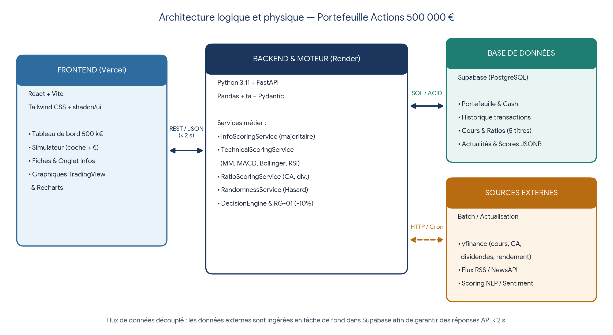
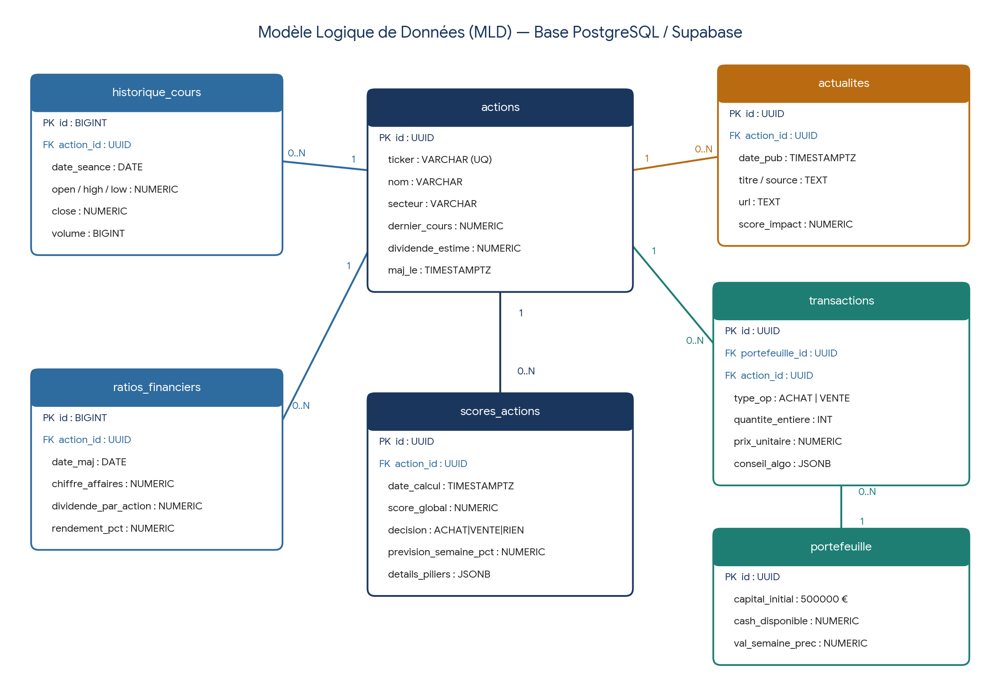
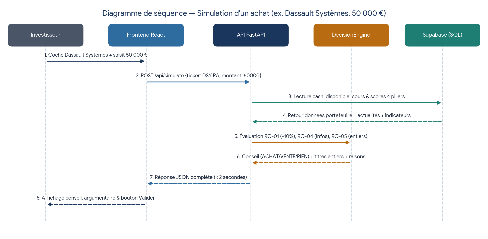

<table>
<colgroup>
<col style="width: 100%" />
</colgroup>
<thead>
<tr class="header">
<th>
<strong>DOSSIER DE CONCEPTION TECHNIQUE (DCT)</strong>

<strong>Architecture, Modèle de Données &amp; Conception Applicative — Portefeuille Actions 500 000 €</strong>

Version 1.0 • Référence : CdCF v2.0 • Stack React / FastAPI / Supabase • 24 novembre 2026
</th>
</tr>
</thead>
<tbody>
</tbody>
</table>

<table>
<colgroup>
<col style="width: 20%" />
<col style="width: 20%" />
<col style="width: 20%" />
<col style="width: 20%" />
<col style="width: 20%" />
</colgroup>
<thead>
<tr class="header">
<th><strong>Frontend</strong></th>
<th><strong>Backend &amp; Moteur</strong></th>
<th><strong>Base de données</strong></th>
<th><strong>Univers cible</strong></th>
<th><strong>Performance cible</strong></th>
</tr>
</thead>
<tbody>
<tr class="odd">
<td><strong>React + Vite</strong> 
Tailwind / TradingView</td>
<td><strong>Python + FastAPI</strong> 
Pandas / ta / Pydantic</td>
<td><strong>Supabase</strong> 
PostgreSQL + JSONB</td>
<td><strong>5 actions CAC 40</strong> 
Budget 500 000 €</td>
<td><strong>&lt; 2 secondes</strong> 
par simulation</td>
</tr>
</tbody>
</table>

**1. Introduction et objectifs de la conception**

Ce Dossier de Conception Technique (DCT) traduit les exigences fonctionnelles et règles de gestion définies dans le Cahier des Charges Fonctionnel (CdCF v2.0) en une architecture logicielle concrète, modulaire et déployable par une équipe de 5 personnes.

Quatre principes d'architecture guident l'ensemble des choix techniques décrits dans ce document :

- **Séparation stricte entre stockage et calcul :** Supabase (PostgreSQL) garantit l'intégrité transactionnelle (ACID) du capital de 500 000 € et des allers-retours fréquents, tandis qu'une API Python (FastAPI) porte les calculs financiers, statistiques et la logique de décision.

- **Réactivité inférieure à 2 secondes :** les flux externes (cours boursiers, ratios, actualités) sont ingérés en tâche de fond dans Supabase. Les requêtes utilisateur lisent directement les données pré-calculées sans latence réseau externe.

- **Modularité des 4 piliers pondérés :** chaque pilier (Informations majoritaire, Analyse graphique, Ratios financiers, Hasard) est encapsulé dans un service indépendant afin de faciliter le développement en parallèle et les tests unitaires.

- **Expérience utilisateur soignée et transparente :** l'interface React masque la complexité mathématique (MACD, Bollinger, RSI, pondérations) derrière des décisions claires (Achat, Vente, Rien) systématiquement argumentées en langage naturel.

**2. Architecture générale du système**

Le système repose sur une architecture trois tiers découplée, complétée par un module d'ingestion asynchrone chargé d'alimenter la base de données à partir des sources financières et d'actualités externes.

*Figure 1 — Architecture logique et physique de l'application (React, FastAPI, Supabase et sources externes).*

**2.1 Justification de la séparation Supabase / FastAPI**

- **Rôle de Supabase (PostgreSQL) :** persistance fiable des 5 valeurs, des historiques de cours, des actualités, du solde de cash et de chaque aller-retour. Les contraintes SQL et transactions garantissent le respect strict de la règle RG-05 (impossibilité de dépenser plus que le cash disponible).

- **Rôle de FastAPI (Python) :** exécution des librairies scientifiques (Pandas, ta) pour calculer les Tendances, Moyennes Mobiles, MACD, Bandes de Bollinger et RSI, appliquer le tirage contrôlé du pilier Hasard, générer les prévisions hebdomadaires et formuler l'argumentaire client.

- **Découplage des sources externes :** un script d'actualisation (exécuté par tâche planifiée ou déclenché à la demande) récupère les données de marché via yfinance et les actualités via flux RSS/NewsAPI, puis stocke les scores calculés dans Supabase.

**3. Choix technologiques justifiés**

| **Couche**           | **Technologies retenues**                   | **Justification par rapport au CdCF**                                                                                                                                         |
|----------------------|---------------------------------------------|-------------------------------------------------------------------------------------------------------------------------------------------------------------------------------|
| **Frontend**         | React 18, Vite, Tailwind CSS, shadcn/ui     | Interface moderne, fluide et esthétique (« jolie »), composants réactifs pour le simulateur (cases à cocher, saisie de montant, badges Achat/Vente/Rien et onglet Infos).     |
| **Visualisation**    | TradingView Lightweight Charts & Recharts   | Courbes boursières professionnelles avec Moyennes Mobiles et Bandes de Bollinger sur les fiches actions ; graphiques de répartition et de performance sur le tableau de bord. |
| **Backend / API**    | Python 3.11, FastAPI, Pydantic              | Exécution rapide, validation automatique des entrées/sorties JSON, documentation Swagger générée nativement pour synchroniser l'équipe.                                       |
| **Moteur financier** | Pandas, NumPy, ta (ou pandas-ta)            | Calcul fiable et standardisé des 5 indicateurs techniques (Tendances, MM, MACD, Bollinger, RSI) et des prévisions de variation hebdomadaire.                                  |
| **Base de données**  | Supabase (PostgreSQL 15)                    | Base relationnelle managée gratuite, idéale pour le travail à 5 ; fiabilité ACID pour les 500 000 € et type JSONB pour l'argumentaire et le détail des 4 piliers.             |
| **Données & Infos**  | yfinance, feedparser (RSS) / NewsAPI, NLP   | Collecte gratuite des cours et ratios (CA, dividende/action, rendement) pour les 5 tickers et alimentation du pilier majoritaire Informations.                                |
| **Hébergement**      | Vercel (Front), Render (API), Supabase (DB) | Déploiement continu connecté à GitHub (CI/CD), accessible en ligne pour la démonstration client et la soutenance.                                                             |

**4. Conception de la base de données (Supabase / PostgreSQL)**

La base de données s'articule autour de 7 tables relationnelles centrées sur la table actions. Les 5 valeurs du périmètre (DSY.PA, RMS.PA, CAP.PA, AI.PA, TTE.PA) sont référencées par un identifiant unique UUID.

*Figure 2 — Modèle Logique de Données (MLD) de la base PostgreSQL hébergée sur Supabase.*

**4.1 Description des tables principales**

| **Table**             | **Rôle métier**                                                      | **Colonnes clés & indexation**                                                                                                                              |
|-----------------------|----------------------------------------------------------------------|-------------------------------------------------------------------------------------------------------------------------------------------------------------|
| **actions**           | Référentiel des 5 titres du CAC 40.                                  | id (PK), ticker (UNIQUE), nom, secteur, dernier_cours, dividende_estime, maj_le.                                                                            |
| **historique_cours**  | Séries temporelles OHLCV pour le calcul technique et les graphiques. | id (PK), action_id (FK), date_seance, open, high, low, close, volume. Index unique sur (action_id, date_seance).                                            |
| **ratios_financiers** | Données fondamentales du bloc Ratios.                                | id (PK), action_id (FK), date_maj, chiffre_affaires, dividende_par_action, rendement_pct.                                                                   |
| **actualites**        | Flux du bloc Informations (pilier majoritaire) et onglet Infos.      | id (PK), action_id (FK), date_pub, titre, source, url, resume, score_impact (0 à 100).                                                                      |
| **scores_actions**    | Cache des scores calculés par le moteur (garantit le \< 2 s).        | id (PK), action_id (FK), date_calcul, score_global, decision (ACHAT/VENTE/RIEN), prevision_semaine_pct, details_piliers (JSONB).                            |
| **portefeuille**      | État du capital de 500 000 € et référence hebdomadaire (RG-01).      | id (PK), capital_initial (500000), cash_disponible, val_semaine_prec, date_ref_semaine.                                                                     |
| **transactions**      | Journal complet des allers-retours validés sur l'horizon d'un an.    | id (PK), portefeuille_id (FK), action_id (FK), type_op (ACHAT/VENTE), quantite_entiere, prix_unitaire, montant_total, conseil_algo (JSONB), date_execution. |

**4.2 Script SQL d'initialisation (Supabase)**

<table>
<colgroup>
<col style="width: 100%" />
</colgroup>
<thead>
<tr class="header">
<th><strong>Extrait DDL PostgreSQL — Exécutable directement dans l'éditeur SQL de Supabase 
</strong>-- 1. Référentiel des 5 actions 
CREATE TABLE actions ( 
id UUID PRIMARY KEY DEFAULT gen_random_uuid(), 
ticker VARCHAR(16) UNIQUE NOT NULL, 
nom VARCHAR(100) NOT NULL, 
secteur VARCHAR(80) NOT NULL, 
dernier_cours NUMERIC(12,2) NOT NULL, 
dividende_estime NUMERIC(10,2) DEFAULT 0, 
maj_le TIMESTAMPTZ DEFAULT NOW() 
); 
 
-- 2. Historique des cours (OHLCV) 
CREATE TABLE historique_cours ( 
id BIGSERIAL PRIMARY KEY, 
action_id UUID NOT NULL REFERENCES actions(id) ON DELETE CASCADE, 
date_seance DATE NOT NULL, 
open NUMERIC(12,2), high NUMERIC(12,2), low NUMERIC(12,2), 
close NUMERIC(12,2) NOT NULL, volume BIGINT, 
UNIQUE (action_id, date_seance) 
); 
 
-- 3. Ratios financiers (CA, dividende/action, rendement) 
CREATE TABLE ratios_financiers ( 
id BIGSERIAL PRIMARY KEY, 
action_id UUID NOT NULL REFERENCES actions(id) ON DELETE CASCADE, 
date_maj DATE NOT NULL, 
chiffre_affaires NUMERIC(18,2), 
dividende_par_action NUMERIC(10,2), 
rendement_pct NUMERIC(6,2) 
); 
 
-- 4. Actualités (Pilier majoritaire Informations &amp; Onglet Infos) 
CREATE TABLE actualites ( 
id UUID PRIMARY KEY DEFAULT gen_random_uuid(), 
action_id UUID NOT NULL REFERENCES actions(id) ON DELETE CASCADE, 
date_pub TIMESTAMPTZ NOT NULL, 
titre TEXT NOT NULL, source VARCHAR(100), url TEXT, 
score_impact NUMERIC(5,2) CHECK (score_impact BETWEEN 0 AND 100) 
); 
 
-- 5. Scores pré-calculés &amp; prévisions hebdomadaires 
CREATE TABLE scores_actions ( 
id UUID PRIMARY KEY DEFAULT gen_random_uuid(), 
action_id UUID NOT NULL REFERENCES actions(id) ON DELETE CASCADE, 
date_calcul TIMESTAMPTZ DEFAULT NOW(), 
score_global NUMERIC(5,2) NOT NULL, 
decision VARCHAR(10) CHECK (decision IN ('ACHAT', 'VENTE', 'RIEN')), 
prevision_semaine_pct NUMERIC(6,2), 
details_piliers JSONB NOT NULL 
); 
 
-- 6. Portefeuille (500 000 € &amp; suivi du garde-fou -10 % / semaine) 
CREATE TABLE portefeuille ( 
id UUID PRIMARY KEY DEFAULT gen_random_uuid(), 
capital_initial NUMERIC(14,2) NOT NULL DEFAULT 500000.00, 
cash_disponible NUMERIC(14,2) NOT NULL DEFAULT 500000.00 CHECK (cash_disponible &gt;= 0), 
val_semaine_prec NUMERIC(14,2) NOT NULL DEFAULT 500000.00, 
date_ref_semaine DATE NOT NULL DEFAULT CURRENT_DATE 
); 
 
-- 7. Historique des allers-retours (RG-05 : quantités entières) 
CREATE TABLE transactions ( 
id UUID PRIMARY KEY DEFAULT gen_random_uuid(), 
portefeuille_id UUID NOT NULL REFERENCES portefeuille(id), 
action_id UUID NOT NULL REFERENCES actions(id), 
type_op VARCHAR(10) CHECK (type_op IN ('ACHAT', 'VENTE')), 
quantite_entiere INT NOT NULL CHECK (quantite_entiere &gt; 0), 
prix_unitaire NUMERIC(12,2) NOT NULL, 
montant_total NUMERIC(14,2) NOT NULL, 
conseil_algo JSONB NOT NULL, 
date_execution TIMESTAMPTZ DEFAULT NOW() 
); 
 
CREATE INDEX idx_hist_action_date ON historique_cours(action_id, date_seance DESC); 
CREATE INDEX idx_news_action_date ON actualites(action_id, date_pub DESC); 
CREATE INDEX idx_tx_pf_date ON transactions(portefeuille_id, date_execution DESC);</th>
</tr>
</thead>
<tbody>
</tbody>
</table>

**5. Conception modulaire du backend (FastAPI / Python)**

Le backend est découpé en services indépendants suivant une architecture en couches (Routes → Services métier → Accès données Supabase). Ce découpage permet aux membres de l'équipe de développer et tester chaque pilier en parallèle sur des branches Git dédiées.

**5.1 Arborescence du projet backend**

<table>
<colgroup>
<col style="width: 100%" />
</colgroup>
<thead>
<tr class="header">
<th><strong>Structure des dossiers backend (FastAPI) 
</strong>backend/ 
├── main.py # Point d'entrée FastAPI, configuration CORS 
├── config.py # Chargement des variables (.env) et pondérations par défaut 
├── db/ 
│ └── supabase_client.py # Connexion PostgreSQL / SDK Supabase 
├── routers/ 
│ ├── dashboard.py # GET /api/dashboard 
│ ├── simulator.py # POST /api/simulate 
│ ├── transactions.py # POST /api/transactions, GET /api/portfolio/history 
│ └── stocks.py # GET /api/stocks/{ticker}, POST /api/market/refresh 
├── services/ 
│ ├── info_scoring.py # Pilier 1 : Informations (majoritaire - RG-04) 
│ ├── technical_scoring.py # Pilier 2 : Tendances, MM, MACD, Bollinger, RSI 
│ ├── ratio_scoring.py # Pilier 3 : CA, dividende/action, rendement + estim. dividendes 
│ ├── randomness_service.py # Pilier 4 : Hasard contrôlé (graine seed) 
│ └── decision_engine.py # Agrégation, prévision hebdo, garde-fou RG-01, argumentaire 
└── tests/ # Suite de tests unitaires pytest (RG-01 à RG-06)</th>
</tr>
</thead>
<tbody>
</tbody>
</table>

**5.2 Responsabilités des services métier**

| **Service Python**          | **Responsabilité & règles implémentées**                                                                                                                                                                                                        | **Sortie standardisée**                                     |
|-----------------------------|-------------------------------------------------------------------------------------------------------------------------------------------------------------------------------------------------------------------------------------------------|-------------------------------------------------------------|
| **InfoScoringService**      | Agrège les actualités récentes depuis Supabase avec décroissance temporelle. Applique le poids majoritaire (RG-04, ex. 40 % par défaut) et extrait les 2 à 3 faits marquants.                                                                   | { score_infos: 0..100, faits_cles: \[...\] }                |
| **TechnicalScoringService** | Calcule Tendances, Moyennes Mobiles (MM20/50/200), MACD, Bandes de Bollinger et RSI sur historique_cours. Calibre les signaux sur un rythme court terme / hebdomadaire.                                                                         | { score_tech: 0..100, signaux: {rsi, macd, bollinger, mm} } |
| **RatioScoringService**     | Normalise le CA, le dividende/action et le rendement sur 100. Calcule le dividende annuel estimé en euros proportionnellement au capital engagé.                                                                                                | { score_ratios: 0..100, dividende_estime_eur: float }       |
| **RandomnessService**       | Génère une composante aléatoire bornée (ex. poids 10 %) modélisant les imprévus hebdomadaires. Accepte un paramètre seed pour rendre les tests reproductibles.                                                                                  | { score_hasard: 0..100, seed: int }                         |
| **DecisionEngine**          | Combine les 4 scores, vérifie RG-04 (poids Infos strictement supérieur), statue ACHAT / VENTE / RIEN (RG-02), estime la variation hebdo, contrôle la perte max -10 % (RG-01), calcule les titres entiers (RG-05) et rédige les raisons (RG-03). | Objet DecisionResponse complet (JSON)                       |

**6. Contrats d'API REST (Interface React ↔ FastAPI)**

Les contrats ci-dessous définissent l'interface officielle entre le frontend React et le backend FastAPI. Ils permettent au développeur frontend de travailler immédiatement avec des données simulées (mocks) avant le branchement final.

<table>
<colgroup>
<col style="width: 33%" />
<col style="width: 33%" />
<col style="width: 33%" />
</colgroup>
<thead>
<tr class="header">
<th><strong>Méthode &amp; Endpoint</strong></th>
<th><strong>Rôle fonctionnel</strong></th>
<th><strong>Paramètres / Réponse principale</strong></th>
</tr>
</thead>
<tbody>
<tr class="odd">
<td><strong>GET /api/dashboard</strong></td>
<td>Charge la vue d'accueil globale (500 000 € et 5 titres).</td>
<td>Renvoie : capital_total, cash_disponible, variation_hebdo_pct, alerte_perte_10pct (bool) et la liste des 5 actions (decision, prevision_semaine_pct, dividende_estime).</td>
</tr>
<tr class="even">
<td><strong>POST /api/simulate</strong></td>
<td>Simulateur interactif d'aller-retour (coche action + montant).</td>
<td>Entrée : { tickers: [...], montant_eur, operation }. 
Sortie : quantite_entiere, reliquat_cash, conseil, raisons[], dividende_estime_eur.</td>
</tr>
<tr class="odd">
<td><strong>POST /api/transactions</strong></td>
<td>Enregistre un aller-retour validé par le client.</td>
<td>Vérifie cash &gt;= montant (RG-05), insère la transaction en base, met à jour cash_disponible dans une transaction SQL atomique.</td>
</tr>
<tr class="even">
<td><strong>GET /api/stocks/{ticker}</strong></td>
<td>Alimente la fiche action et l'onglet « Infos sur l'action ».</td>
<td>Renvoie : historique OHLCV + indicateurs (MM, Bollinger, RSI, MACD), actualités récentes, ratios (CA, dividende, rendement), scénarios hebdo et argumentaire.</td>
</tr>
<tr class="odd">
<td><strong>GET /api/portfolio/history</strong></td>
<td>Suivi des allers-retours et de la performance sur 1 an (RG-06).</td>
<td>Renvoie l'historique paginé des transactions et la courbe de valorisation du portefeuille.</td>
</tr>
<tr class="even">
<td><strong>POST /api/market/refresh</strong></td>
<td>Actualisation manuelle ou planifiée des données externes.</td>
<td>Déclenche la collecte yfinance + actualités et recalcule la table scores_actions.</td>
</tr>
</tbody>
</table>

**6.1 Exemple de contrat JSON — POST /api/simulate**

<table>
<colgroup>
<col style="width: 100%" />
</colgroup>
<thead>
<tr class="header">
<th><strong>Exemple d'échange JSON pour le simulateur d'aller-retour 
</strong>// Requête envoyée par React (client coche Dassault Systèmes et saisit 50 000 €) 
{ 
"ticker": "DSY.PA", 
"operation": "ACHAT", 
"montant_eur": 50000 
} 
 
// Réponse renvoyée par FastAPI (&lt; 2 secondes) 
{ 
"ticker": "DSY.PA", 
"nom": "Dassault Systèmes", 
"cours_actuel": 34.80, 
"quantite_entiere": 1436, 
"montant_reel_investi": 49972.80, 
"reliquat_cash": 27.20, 
"conseil": "ACHAT", 
"prevision_semaine_pct": { "defavorable": -1.8, "central": 3.4, "favorable": 7.2 }, 
"dividende_annuel_estime_eur": 416.44, 
"alerte_risque_rg01": false, 
"raisons": [ 
"Informations (poids majoritaire) : annonce de nouveaux contrats industriels bien accueillie.", 
"Analyse graphique : rebond au-dessus de la moyenne mobile 20 jours et croisement haussier MACD.", 
"Ratios : croissance régulière du chiffre d'affaires et dividende stable." 
] 
}</th>
</tr>
</thead>
<tbody>
</tbody>
</table>

**7. Conception du Frontend (React / Vite)**

Le frontend est conçu comme une Single Page Application (SPA) privilégiant la clarté visuelle et la rapidité d'action pour un investisseur actif. Les formules internes et pondérations restent masquées par défaut.

| **Vue / Composant React** | **Route**       | **Fonctions et composants clés**                                                                                                                                                               |
|---------------------------|-----------------|------------------------------------------------------------------------------------------------------------------------------------------------------------------------------------------------|
| **DashboardPage**         | /               | Cartes KPI (Capital total, Cash, Perf. semaine, Bandeau d'alerte rouge si perte \>= 10 %) + Tableau des 5 actions (badges Achat / Vente / Rien, prévision hebdo, dividende estimé).            |
| **SimulatorPanel**        | Intégré sur /   | Cases à cocher des 5 actions, champ montant en €, sélecteur Achat/Vente, affichage instantané du conseil argumenté, nombre de titres entiers et bouton « Valider l'aller-retour ».             |
| **StockDetailPage**       | /action/:ticker | Graphique interactif (TradingView) + bloc Recommandation & Argumentaire + prévision sur 1 semaine + simulateur de dividende + Onglet dédié « Infos sur l'action » (actualités, CA, rendement). |
| **HistoryPage**           | /historique     | Journal des allers-retours effectués sur l'horizon d'un an, plus/moins-values réalisées et courbe d'évolution du portefeuille.                                                                 |

**8. Dynamique du système — Scénario principal**

Le diagramme de séquence ci-dessous illustre le parcours central demandé par le client : la simulation d'un achat sur Dassault Systèmes avec vérification en temps réel des règles de gestion et génération de l'argumentaire.

*Figure 3 — Diagramme de séquence du scénario « Cocher une action + saisir un montant + obtenir le conseil argumenté ».*

**9. Contraintes techniques, sécurité, tests et déploiement**

**9.1 Performance et fiabilité**

- **Objectif de latence (\< 2 secondes) :** les requêtes de simulation lisent exclusivement dans les tables indexées de Supabase (aucun appel synchrone à yfinance ou NewsAPI lors d'une action utilisateur).

- **Intégrité des transactions :** chaque validation d'aller-retour met à jour transactions et portefeuille.cash_disponible au sein d'une même transaction SQL pour empêcher tout solde négatif ou double débit.

- **Reproductibilité du pilier Hasard :** la graine aléatoire (seed) utilisée lors d'une décision est enregistrée dans conseil_algo (JSONB) afin de pouvoir auditer ou rejouer n'importe quelle recommandation.

**9.2 Sécurité et confidentialité**

- **Gestion des secrets :** les clés d'API (SUPABASE_KEY, NEWS_API_KEY) sont stockées uniquement côté backend dans des variables d'environnement (.env), jamais exposées dans le bundle React ni versionnées sur GitHub.

- **Validation des entrées :** toutes les requêtes API sont validées par des schémas Pydantic (montant strictement positif, ticker appartenant aux 5 valeurs autorisées, opération limitée à ACHAT ou VENTE).

- **CORS et accès base :** FastAPI n'autorise que l'origine du frontend déployé sur Vercel ; les accès écriture à Supabase passent exclusivement par le backend.

**9.3 Stratégie de tests techniques**

| **Niveau de test**                | **Outils**                        | **Périmètre vérifié**                                                                                                                                                    |
|-----------------------------------|-----------------------------------|--------------------------------------------------------------------------------------------------------------------------------------------------------------------------|
| **Tests unitaires**               | pytest (Python)                   | Calcul exact des 5 indicateurs techniques (MM, MACD, Bollinger, RSI), respect de RG-01 (-10 %), RG-04 (poids Infos majoritaire), RG-05 (titres entiers + reliquat cash). |
| **Tests d'API**                   | Swagger UI / Postman / TestClient | Validation des codes HTTP (200, 400 si solde insuffisant, 404 si ticker inconnu), conformité des payloads JSON et temps de réponse \< 2 s.                               |
| **Tests d'intégration & recette** | Scénario bout-en-bout             | Exécution complète d'un aller-retour (achat puis revente) sur Dassault Systèmes et vérification de la cohérence du capital de 500 000 € dans Supabase et React.          |

**9.4 Organisation Git et déploiement en équipe (5 personnes)**

- **Workflow Git :** une branche principale protégée (main) et des branches par module (feat/infos, feat/graphique, feat/ratios-hasard, feat/moteur-api, feat/frontend-react) fusionnées via Pull Requests après relecture.

- **Environnement de démonstration :** déploiement automatique du frontend sur Vercel, de l'API FastAPI sur Render et base de données partagée sur Supabase, garantissant une URL fonctionnelle unique pour la présentation finale.

<table>
<colgroup>
<col style="width: 100%" />
</colgroup>
<thead>
<tr class="header">
<th><strong>Traçabilité avec les livrables suivants 
</strong>Les formules mathématiques détaillées de normalisation sur 100, les seuils exacts de déclenchement (Achat / Vente / Rien) ainsi que les maquettes graphiques (wireframes Figma) de chaque écran sont précisés dans le Dossier de Spécification.</th>
</tr>
</thead>
<tbody>
</tbody>
</table>
