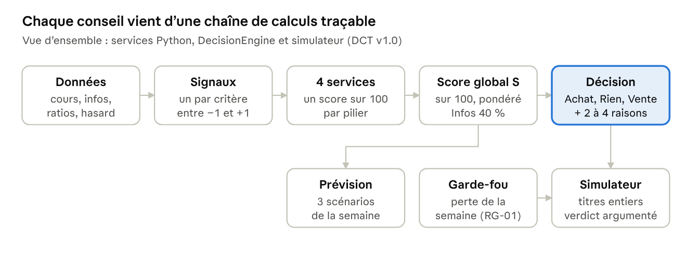
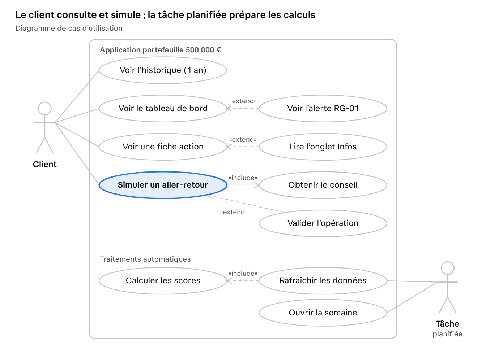
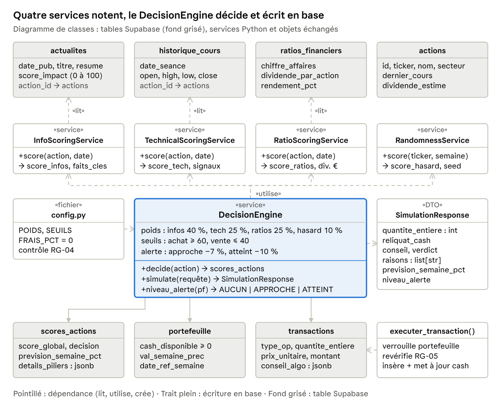
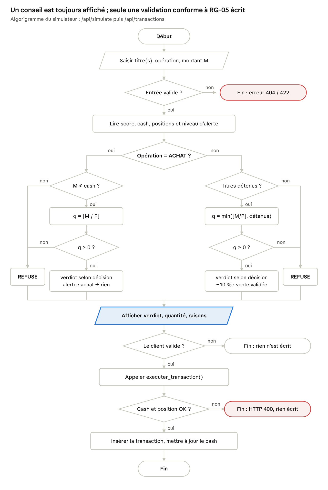

# Dossier de spécification — Application portefeuille actions 500 000 €

Nov 24, 2026 · @dread

Livrable 3 du projet. Ce dossier fixe les diagrammes UML, la logique de chaque traitement et les formules du moteur. Il s'aligne sur le **Dossier de Conception Technique v1.0** de l'équipe (7 tables Supabase, services Python par pilier, routes FastAPI, pages React) et sur le CdCF v2.0. En cas d'écart sur une formule ou un seuil, c'est ce dossier qui fait foi.

vue d'ensemble · du précalcul au simulateur

**Sommaire**

| Partie                      | Ce qu'on y trouve                              |
|-----------------------------|------------------------------------------------|
| 1\. Le principe en une page | 4 notes sur 100, une moyenne, un conseil       |
| 2\. Diagrammes UML          | Cas d'utilisation, classes, algorigramme       |
| 3\. Analyse graphique       | D'où viennent les données, les 5 indicateurs   |
| 4\. Informations            | Note des actualités, articles récents          |
| 5\. Ratios financiers       | Chiffre d'affaires, dividende, rendement       |
| 6\. Hasard                  | Tirage fixe pour la semaine, influence limitée |
| 7\. La décision             | Poids, seuils 60 / 40, exemple complet         |
| 8\. Les raisons affichées   | Phrases en français courant (RG-03)            |
| 9\. La prévision            | 3 scénarios pour la semaine                    |
| 10\. Le simulateur          | Achat, vente, verdict, enregistrement          |
| 11\. Tableau de bord        | Valeur, alerte de perte, historique            |
| 12\. Vérifications          | 16 tests chiffrés, points à valider            |
| Annexe technique            | Formats JSON, fonction SQL, codes d'erreur     |

Les **encadrés** contiennent les exemples chiffrés et les points à retenir. Les couleurs suivent la convention des badges React : vert pour l'achat ou une situation normale, gris pour « rien », jaune pour la prudence, rouge pour la vente ou l'alerte.

## 1. À quoi sert ce dossier

Ce dossier explique **comment l'application calcule ses conseils**. Il complète le cahier des charges (le besoin) et le dossier de conception (l'architecture). Les détails réservés aux développeurs (formats JSON, code SQL) sont regroupés dans l'annexe technique, à la fin.

### 1.1 Le principe en une phrase

Pour chacune des 5 actions, on donne **4 notes sur 100** (informations, graphique, ratios, hasard), on en fait une **moyenne pondérée**, et selon le résultat on conseille **Achat, Vente ou Rien**.

### 1.2 Comment lire une note sur 100

| Note          | Signification                      |
|---------------|------------------------------------|
| Proche de 100 | Très favorable : pousse à acheter  |
| 50            | Neutre : ni pour, ni contre        |
| Proche de 0   | Très défavorable : pousse à vendre |

Pour fabriquer ces notes, chaque indicateur donne d'abord un **signal entre −1 et +1** : +1 veut dire « acheter », −1 « vendre », 0 « neutre ». On passe ensuite à une note sur 100 avec une seule formule :

**note sur 100 = 50 + 50 × signal**

Exemples : un signal de +1 donne 100, un signal de 0 donne 50, un signal de −0,4 donne 30.

### 1.3 Quand les calculs sont faits

Les calculs lourds sont faits **à l'avance**, tous les jours à 18 h et chaque heure pendant la séance, par la route POST /api/market/refresh. Les résultats sont rangés dans la table scores_actions. Quand le client clique, l'application ne fait que lire ces résultats : c'est ce qui permet de répondre en moins de 2 secondes.

Tous les réglages (poids, seuils, durées) sont dans le fichier config.py, pour pouvoir les changer sans toucher au code.

## 2. Diagrammes UML

### 2.1 Cas d'utilisation

Deux acteurs : le **client**, qui consulte et simule depuis les pages React, et la **tâche planifiée**, qui appelle POST /api/market/refresh pour préparer les calculs.

UML · cas d'utilisation · 2 acteurs, 11 cas

| Cas d'utilisation                                              | Page React (DCT) | Route                      |
|----------------------------------------------------------------|------------------|----------------------------|
| Voir le tableau de bord, voir l'alerte RG-01                   | DashboardPage    | GET /api/dashboard         |
| Simuler un aller-retour, obtenir le conseil                    | SimulatorPanel   | POST /api/simulate         |
| Valider l'opération                                            | SimulatorPanel   | POST /api/transactions     |
| Voir une fiche action, lire l'onglet Infos                     | StockDetailPage  | GET /api/stocks/{ticker}   |
| Voir l'historique (1 an)                                       | HistoryPage      | GET /api/portfolio/history |
| Rafraîchir les données, calculer les scores, ouvrir la semaine | —                | POST /api/market/refresh   |

«include» : le cas de base déclenche toujours le cas inclus (une simulation produit toujours un conseil argumenté). «extend» : le cas s'ajoute dans certaines conditions (l'alerte n'apparaît qu'en cas de perte, la validation seulement si le client le décide).

### 2.2 Diagramme de classes

Le diagramme reprend exactement les noms du DCT : les quatre services de piliers de backend/services/, le DecisionEngine qui les combine, et les tables Supabase qu'ils lisent ou écrivent.

UML · classes · 4 services, DecisionEngine, 7 tables

| Élément                 | Rôle                                                                                          | Spécifié en |
|-------------------------|-----------------------------------------------------------------------------------------------|-------------|
| InfoScoringService      | Lit actualites, rend score_infos et faits_cles                                                | 4           |
| TechnicalScoringService | Lit historique_cours, rend score_tech et signaux                                              | 3           |
| RatioScoringService     | Lit ratios_financiers et actions.dividende_estime, rend score_ratios et le dividende estimé   | 5           |
| RandomnessService       | Rend score_hasard et la graine, sans lire la base                                             | 6           |
| config.py               | Poids, seuils, frais ; contrôle RG-04 au démarrage                                            | 7.1         |
| DecisionEngine          | Combine les 4 scores, écrit scores_actions, simule les opérations, calcule le niveau d'alerte | 7 à 11      |
| SimulationResponse      | Réponse de /api/simulate (contrat du DCT + verdict, niveau_alerte)                            | 10.6        |
| executer_transaction()  | Fonction PostgreSQL appelée par /api/transactions : écriture atomique                         | 10.7        |

### 2.3 Algorigramme du simulateur

L'algorigramme déroule le traitement d'une opération, de la saisie dans le SimulatorPanel jusqu'à l'écriture en base. Il reprend les règles des sections 10 et 11.

algorigramme · simulateur et enregistrement

| Symbole         | Signification                                                            |
|-----------------|--------------------------------------------------------------------------|
| Ovale           | Début ou fin du traitement (en rouge : fin sur erreur)                   |
| Parallélogramme | Entrée ou sortie d'informations (saisie du client, affichage du conseil) |
| Rectangle       | Traitement ou calcul                                                     |
| Losange         | Test, avec une sortie « oui » et une sortie « non »                      |

- Une opération impossible ne bloque pas le parcours : elle aboutit au verdict REFUSE, qui est **affiché avec sa raison** comme tout autre conseil (RG-03).

- Le test « Cash et position OK ? » est refait dans la fonction SQL au moment de l'enregistrement : entre le conseil et la validation, le cours ou le cash ont pu changer (RG-05).

- Seule la branche du bas écrit en base ; toutes les autres fins laissent la base inchangée.

## 3. Analyse graphique (TechnicalScoringService)

### 3.1 D'où viennent les données ?

**On récupère seulement les cours bruts, et on calcule nous-mêmes les indicateurs.**

1.  Chaque jour, yfinance (gratuit) fournit pour les 5 titres le cours d'ouverture, le plus haut, le plus bas, la clôture et le volume. Ils sont rangés dans la table historique_cours.

2.  Le service calcule ensuite les 5 indicateurs avec la bibliothèque Python ta, prévue par le dossier de conception.

| Option                                     | Avantages                                                                                              | Inconvénients                                                                                      |
|--------------------------------------------|--------------------------------------------------------------------------------------------------------|----------------------------------------------------------------------------------------------------|
| **Calcul par nous (retenu)**               | Gratuit, sans limite d'appels ; mêmes réglages pour les 5 titres ; résultats vérifiables par des tests | Il faut stocker au moins 1 an de cours (200 séances pour la MM200)                                 |
| API qui fournit les indicateurs tout faits | Rien à calculer                                                                                        | Offres gratuites très limitées en nombre d'appels ; réglages imposés ; dépendance à un fournisseur |

### 3.2 Les 5 indicateurs en un coup d'œil

| Indicateur          | Ce qu'il regarde                                                  | Signal +1 (achat)                                           | Signal −1 (vente)                         | Importance (sur 10) |
|---------------------|-------------------------------------------------------------------|-------------------------------------------------------------|-------------------------------------------|---------------------|
| Bandes de Bollinger | Un « couloir » autour de la moyenne des 20 derniers jours         | Le cours touche le bas du couloir                           | Le cours touche le haut du couloir        | 9                   |
| RSI                 | Les hausses comparées aux baisses des 14 derniers jours (0 à 100) | RSI de 30 ou moins : le titre a trop baissé                 | RSI de 70 ou plus : le titre a trop monté | 7                   |
| MACD                | L'écart entre une moyenne courte (12 j) et une longue (26 j)      | La courte repasse au-dessus de la longue                    | La courte repasse en dessous              | 6                   |
| Moyennes mobiles    | La moyenne des cours sur 20, 50 et 200 jours                      | Le cours et les moyennes courtes sont au-dessus des longues | Ils sont en dessous                       | 5                   |
| Tendance            | La direction du cours sur un mois                                 | Hausse de 3 % par semaine ou plus                           | Baisse de 3 % par semaine ou plus         | 5                   |

Entre ces deux extrêmes, le signal varie progressivement entre +1 et −1.

### 3.3 Le détail de chaque calcul

**Bandes de Bollinger**

- **milieu = moyenne des 20 derniers cours** ; **haut = milieu + 2 × écart-type** ; **bas = milieu − 2 × écart-type**

- **position = (cours − bas) / (haut − bas)** : 0 quand le cours est sur le bas, 1 quand il est sur le haut

- **signal = 1 − 2 × position**

> **Exemple** : couloir de 95 € à 105 €, cours à 96 €. Position = 1 / 10 = 0,1, donc signal = **+0,8** : le cours est bas, plutôt achat.

**RSI**

- **RSI = 100 − 100 / (1 + moyenne des hausses / moyenne des baisses)**, sur 14 séances

- **signal = (50 − RSI) / 20**, limité entre −1 et +1 (RSI 30 → +1 ; RSI 50 → 0 ; RSI 70 → −1)

> **Exemple** : RSI = 35, donc signal = 15 / 20 = **+0,75**.

**MACD**

- **MACD = moyenne exponentielle sur 12 jours − moyenne exponentielle sur 26 jours** (une moyenne « exponentielle » donne plus de poids aux jours récents)

- **ligne de signal = moyenne exponentielle sur 9 jours du MACD**

- Le MACD vient de passer au-dessus de sa ligne de signal → **+1** ; en dessous → **−1** ; il reste au-dessus → **+0,5** ; il reste en dessous → **−0,5**

**Moyennes mobiles**

Trois comparaisons, chacune notée de −1 à +1 :

1.  le cours face à la MM20 (+1 s'il est 2 % au-dessus ou plus) ;

2.  la MM20 face à la MM50 (+1 à 3 % au-dessus) ;

3.  la MM50 face à la MM200 (+1 à 5 % au-dessus).

**signal = (2 × comparaison 1 + comparaison 2 + comparaison 3) / 4** : la première compte double car l'horizon du client est la semaine.

**Tendance**

On trace la droite qui passe au plus près des 20 derniers cours. Sa pente donne la progression moyenne par semaine. **signal = progression par semaine / 3 %**, limité entre −1 et +1.

### 3.4 La note du pilier

**note graphique = 50 + 50 × (moyenne des 5 signaux, pondérée par leur importance)**

> **Exemple** : Bollinger +0,8 (×9), RSI +0,75 (×7), MACD −0,5 (×6), moyennes mobiles −0,4 (×5), tendance −0,2 (×5). Moyenne pondérée = 6,45 / 32 = 0,20. Note graphique = 50 + 50 × 0,20 = **60,1**.

Si un indicateur ne peut pas être calculé (historique trop court), il est simplement ignoré dans la moyenne.

## 4. Pilier Informations (InfoScoringService)

C'est le pilier le plus important (40 % de la décision). Il transforme les actualités récentes d'un titre en une note sur 100.

### 4.1 Les étapes

1.  **Noter chaque article.** À la collecte, un modèle d'analyse de texte lit le titre et le résumé, et dit si l'article est positif ou négatif : c'est le sentiment s, entre −1 et +1. On en tire une note d'impact sur 100, rangée dans actualites.score_impact :

**note d'impact = 50 + 50 × s × importance**

L'importance vaut 1 pour une annonce officielle (résultats, gros contrat, avertissement, fusion, changement de dirigeant) et 0,5 pour une actualité ordinaire. Une annonce pèse donc deux fois plus.

2.  **Donner plus de poids aux articles récents.** Un article perd la moitié de son poids tous les 2 jours. Au-delà de 7 jours, il est ignoré.

| Âge de l'article | Aujourd'hui | 1 jour | 2 jours | 4 jours | 7 jours |
|------------------|-------------|--------|---------|---------|---------|
| Poids            | 1           | 0,71   | 0,50    | 0,25    | 0,09    |

3.  **Faire la moyenne.**

**note Informations = moyenne des notes d'impact, pondérée par le poids de chaque article**

4.  **Garder les faits marquants.** Les 3 articles qui pèsent le plus servent à expliquer la décision au client (section 8) et remplissent l'onglet « Infos sur l'action ».

Sans aucun article sur 7 jours, la note vaut 50 (neutre) et l'application affiche « aucune actualité récente ».

> **Exemple** : un article d'hier noté 80 (poids 0,71) et un article d'il y a 4 jours noté 30 (poids 0,25). Note = (0,71 × 80 + 0,25 × 30) / (0,71 + 0,25) = **66,9**. L'article récent l'emporte.

### 4.2 L'« impact récent » affiché dans l'onglet Infos

C'est le nombre de points que les actualités ajoutent (ou retirent) à la note finale : **impact = 0,40 × (note Informations − 50)**. Dans l'exemple : 0,40 × 16,9 = **+6,8 points**.

## 5. Pilier Ratios financiers (RatioScoringService)

Ces chiffres ne changent qu'une ou deux fois par an : ils donnent la « santé de fond » de l'entreprise. Ils viennent de la table ratios_financiers (dernier exercice et exercice précédent).

| Critère              | Question posée                                                 | Signal +1                                 | Signal 0          | Signal −1             | Importance |
|----------------------|----------------------------------------------------------------|-------------------------------------------|-------------------|-----------------------|------------|
| Chiffre d'affaires   | Les ventes progressent-elles ?                                 | +10 % ou plus sur un an                   | +5 %              | Baisse                | 7          |
| Dividende par action | Le dividende augmente-t-il ?                                   | Hausse de plus de 1 %                     | Stable            | Baisse ou suppression | 6          |
| Rendement            | Le dividende est-il généreux par rapport au prix de l'action ? | 50 % au-dessus de la moyenne des 5 titres | Égal à la moyenne | 50 % en dessous       | 6          |

**note Ratios = 50 + 50 × (moyenne des 3 signaux, pondérée par leur importance)**

> **Exemple** : CA +7 % (signal +0,4), dividende +8 % (+1), rendement de 0,8 % contre 2,6 % en moyenne (−1). Moyenne pondérée = (7 × 0,4 + 6 × 1 − 6 × 1) / 19 = 0,15. Note Ratios = **57,4**.

### 5.1 Dividende estimé

**dividende estimé en euros = nombre d'actions × dividende par action attendu**

Le dividende par action attendu est celui versé sur les 12 derniers mois, ou le montant déjà annoncé par l'entreprise s'il existe. Dans le simulateur, on utilise le nombre d'actions que le client s'apprête à acheter ; sur la fiche, celui qu'il détient. Les montants sont avant impôts.

> **Exemple** : 1 436 actions Dassault Systèmes × 0,29 € = **416,44 € par an**.

## 6. Pilier Hasard (RandomnessService)

Le hasard représente ce que personne ne peut prévoir sur une semaine. Il pèse peu (10 %) et il est contrôlé.

1.  On tire un nombre au hasard entre 0 et 100 : c'est la **note Hasard**.

2.  Le tirage dépend du titre et de la semaine (par exemple « DSY.PA, semaine 48 »). Il reste donc **le même toute la semaine** : le conseil ne change pas à chaque clic.

3.  Le numéro de tirage (la « graine ») est enregistré avec chaque conseil, pour pouvoir le rejouer et le vérifier.

**Pourquoi le hasard ne peut pas décider seul** : il compte pour 10 %, donc il déplace la note finale d'au plus 5 points (0,10 × 50). Or il faut s'éloigner de 10 points du neutre pour déclencher un Achat ou une Vente (section 7). Le hasard peut seulement faire basculer un titre déjà tout proche d'un seuil.

## 7. La décision (DecisionEngine)

### 7.1 Combiner les 4 notes

Le client a donné une note d'importance à chaque pilier : Informations 8, Graphique 5, Ratios 5, Hasard 2 (total 20). Diviser par 20 donne les poids du dossier de conception :

| Pilier       | Importance donnée par le client | Poids    |
|--------------|---------------------------------|----------|
| Informations | 8 sur 20                        | **40 %** |
| Graphique    | 5 sur 20                        | 25 %     |
| Ratios       | 5 sur 20                        | 25 %     |
| Hasard       | 2 sur 20                        | 10 %     |

**note finale = 0,40 × Informations + 0,25 × Graphique + 0,25 × Ratios + 0,10 × Hasard**

Règle RG-04 : le poids des Informations doit rester le plus fort des quatre. Au démarrage, l'application le vérifie et refuse de se lancer si ce n'est pas le cas.

### 7.2 De la note au conseil

| Note finale    | Conseil                      |
|----------------|------------------------------|
| 60 ou plus     | ACHAT                        |
| Entre 40 et 60 | RIEN (conserver ou attendre) |
| 40 ou moins    | VENTE                        |

Plus la note est loin de 50, plus le conseil est sûr. L'application l'affiche comme une **confiance** : faible, moyenne ou forte.

### 7.3 Exemple complet

| Pilier          | Note     | Poids | Points apportés par rapport à 50 |
|-----------------|----------|-------|----------------------------------|
| Informations    | 66,9     | 40 %  | +6,8                             |
| Graphique       | 60,1     | 25 %  | +2,5                             |
| Ratios          | 57,4     | 25 %  | +1,9                             |
| Hasard          | 37,2     | 10 %  | −1,3                             |
| **Note finale** | **59,9** |       | **+9,9**                         |

59,9 est juste sous 60 : le conseil est **RIEN**.

> **À retenir** : avec un hasard neutre (50), la note aurait été 61,1 et le conseil ACHAT. Le hasard n'a pas créé le signal, il a seulement fait basculer un titre qui était tout près du seuil. Les actualités apportent ici les deux tiers des points, comme le veut RG-04.

### 7.4 Ce qui est enregistré

À chaque calcul, une ligne par titre est ajoutée dans scores_actions : la note finale, le conseil, la prévision de la semaine et le détail des 4 piliers (format décrit dans l'annexe technique).

## 8. Les raisons affichées au client (RG-03)

Aucun conseil n'apparaît sans **2 à 4 raisons** en français courant.

### 8.1 Comment on les choisit

1.  On regarde quels piliers ont le plus poussé dans le sens du conseil.

2.  On écrit une phrase par pilier important, en commençant par le plus fort.

3.  On ajoute un **point de vigilance** si un pilier pousse nettement dans l'autre sens.

4.  Si l'alerte de perte est active, sa phrase passe en premier.

5.  Le hasard n'est jamais présenté comme une raison.

### 8.2 Comment on traduit les indicateurs

Le client ne voit jamais « MACD = −0,42 ». Il lit une phrase :

| Indicateur       | Phrase quand il est favorable                                                | Phrase quand il est défavorable                              |
|------------------|------------------------------------------------------------------------------|--------------------------------------------------------------|
| Bollinger        | Le cours est proche du bas de sa fourchette habituelle                       | Le cours est au plus haut de sa fourchette habituelle        |
| RSI              | Le titre a beaucoup baissé récemment, un rebond est fréquent                 | Le titre a beaucoup monté récemment, une pause est fréquente |
| MACD             | La dynamique repart à la hausse                                              | La dynamique se retourne à la baisse                         |
| Moyennes mobiles | Le cours repasse au-dessus de sa moyenne sur 20 jours                        | Le cours passe sous sa moyenne sur 20 jours                  |
| Tendance         | Le cours progresse depuis un mois                                            | Le cours recule depuis un mois                               |
| Informations     | Reprise du fait marquant : « nouveaux contrats industriels bien accueillis » | « Avertissement sur les résultats »                          |
| Ratios           | Chiffre d'affaires ou dividende en hausse                                    | Chiffre d'affaires ou dividende en baisse                    |

> **Exemple (suite de 7.3)** — Conseil RIEN, note 59,9

1.  Note de 59,9, juste sous le seuil d'achat (60) : signaux plutôt favorables mais pas assez nets.

2.  Informations (poids majoritaire) : annonce de nouveaux contrats industriels bien accueillie.

3.  Analyse graphique : cours proche du bas de sa fourchette habituelle, mais dynamique encore baissière.

4.  Ratios : dividende en hausse de 8 %.

## 9. La prévision de la semaine

Pour chaque titre, l'application affiche trois scénarios pour la semaine : favorable, central et défavorable.

### 9.1 Les étapes

1.  **Regarder l'année passée.** Sur les 52 dernières semaines, on calcule la variation moyenne d'une semaine (**μ**) et l'écart habituel autour de cette moyenne (**σ**, la volatilité).

2.  **Décaler selon la note finale.** Une note au-dessus de 50 décale la prévision vers le haut, une note en dessous la décale vers le bas :

**scénario central = μ + (note finale − 50) / 50 × σ**

3.  **Encadrer.** **scénario favorable = central + σ** ; **scénario défavorable = central − σ**. En temps normal, environ 2 semaines sur 3 tombent entre les deux.

4.  **Traduire en euros.** **gain ou perte attendu = scénario × valeur de la position**.

Avec moins de 6 mois d'historique, la prévision n'est pas affichée.

> **Exemple** : μ = +0,2 %, σ = 2,5 %, note finale 59,9 (soit +0,2 après le calcul (59,9 − 50) / 50). Position de 49 972,80 €.

| Scénario    | Variation | En euros |
|-------------|-----------|----------|
| Favorable   | +3,2 %    | +1 599 € |
| Central     | +0,7 %    | +350 €   |
| Défavorable | −1,8 %    | −900 €   |

Une semaine à +10 % sort très largement de ces scénarios habituels : la prévision montre honnêtement que l'objectif du client est très ambitieux.

## 10. Le simulateur, étape par étape

Le client coche une action, choisit achat ou vente et saisit un montant. L'application répond par un conseil, **sans rien enregistrer**. Elle n'enregistre que si le client clique sur « Valider ». L'algorigramme de la section 2.3 montre le même parcours en schéma.

### 10.1 Achat

1.  Le montant dépasse le cash disponible ? → **refusé** (« vous disposez de X € »).

2.  Calculer le nombre d'actions : **nombre d'actions = partie entière de (montant / cours)**. Le reste du montant reste en cash (RG-05).

3.  Le montant ne permet pas d'acheter une seule action ? → **refusé**.

4.  Comparer avec le conseil du titre (section 7) pour donner le verdict.

> **Exemple** : 50 000 € sur Dassault Systèmes à 34,80 €. 50 000 / 34,80 = 1 436,78, donc **1 436 actions** pour 49 972,80 €. Il reste **27,20 €** en cash.

### 10.2 Vente

1.  Le client ne détient pas ce titre ? → **refusé** (pas de vente à découvert).

2.  Calculer le nombre d'actions : partie entière de (montant / cours), **sans dépasser les actions détenues**.

3.  Comparer avec le conseil du titre pour donner le verdict.

Les actions détenues se calculent à partir de l'historique : **actions détenues = actions achetées − actions vendues**.

### 10.3 Le verdict

| Le client veut… | Conseil du titre | Verdict affiché                      |
|-----------------|------------------|--------------------------------------|
| Acheter         | ACHAT            | Valider l'achat                      |
| Acheter         | RIEN             | Ne rien faire pour l'instant         |
| Acheter         | VENTE            | Privilégier la vente, ne pas acheter |
| Vendre          | VENTE            | Valider la vente                     |
| Vendre          | RIEN             | Ne rien faire pour l'instant         |
| Vendre          | ACHAT            | Conserver la position                |
| Impossible      | —                | Refusé, avec la raison               |

Si l'alerte de perte est active (section 11), un achat n'est jamais conseillé. Le client reste libre de passer outre (sauf refus) : le conseil sert d'aide, pas d'interdiction.

### 10.4 L'enregistrement

Quand le client valide, l'enregistrement se fait **d'un seul bloc** par une fonction de la base de données (executer_transaction) :

1.  elle revérifie que le cash suffit (ou que les actions sont bien détenues), car le cours a pu bouger depuis le conseil ;

2.  elle enregistre l'opération ;

3.  elle met à jour le cash.

Si une vérification échoue, **rien n'est enregistré** et le client voit un message d'erreur. Le code de cette fonction est dans l'annexe technique.

## 11. Tableau de bord, alerte de perte et historique

### 11.1 Les chiffres du tableau de bord

| Chiffre affiché                | Calcul                                                                |
|--------------------------------|-----------------------------------------------------------------------|
| Valeur du portefeuille         | **cash + somme (actions détenues × dernier cours)** pour les 5 titres |
| Part investie                  | **(valeur − cash) / valeur**                                          |
| Performance de la semaine      | **valeur actuelle / valeur du lundi − 1**                             |
| Dividende estimé par titre     | Actions détenues × dividende attendu (section 5.1)                    |
| Conseil et prévision par titre | Dernière ligne de scores_actions                                      |

La valeur du lundi est enregistrée chaque lundi à l'ouverture (val_semaine_prec). La première semaine, elle vaut 500 000 €.

### 11.2 L'alerte de perte (RG-01)

| Niveau   | Performance de la semaine | Sur 500 000 €              | Ce que fait l'application                             |
|----------|---------------------------|----------------------------|-------------------------------------------------------|
| Normal   | Au-dessus de −7 %         | Perte de moins de 35 000 € | Indicateur vert                                       |
| Approche | Entre −7 % et −10 %       | Perte de 35 000 à 50 000 € | Bandeau orange ; plus aucun achat conseillé           |
| Atteint  | −10 % ou moins            | Perte de 50 000 € ou plus  | Bandeau rouge sur toutes les pages ; vente conseillée |

Le niveau est recalculé à chaque mise à jour des cours et après chaque opération. Chaque lundi, tout repart de zéro.

**Test de l'alerte (recette REC-4)** : on simule une baisse de tous les cours et on vérifie que l'alerte passe au rouge à −10 %.

> **Exemple** : 400 000 € investis et 100 000 € en cash. Pour perdre 50 000 €, il faut que les actions perdent 50 000 / 400 000 = **12,5 %**. Une baisse simulée de 12,5 % doit donc déclencher l'alerte rouge.

### 11.3 L'historique sur 1 an (RG-06)

La page Historique montre les 365 derniers jours :

- la liste des achats et ventes, avec le gain ou la perte réalisé sur chaque vente (**gain = actions vendues × (prix de vente − prix d'achat moyen)**) ;

- la courbe de valeur du portefeuille, jour par jour ;

- les dividendes qui auraient été perçus.

## 12. Vérifications et points à valider

### 12.1 Résultats attendus (tests automatiques)

Chaque exemple de ce dossier devient un test : l'application doit retrouver exactement ces résultats.

| \#  | Situation                                                 | Résultat attendu                                             |
|-----|-----------------------------------------------------------|--------------------------------------------------------------|
| V1  | Cours à 96 € dans un couloir de Bollinger de 95 à 105 €   | Signal +0,8                                                  |
| V2  | RSI de 35                                                 | Signal +0,75                                                 |
| V3  | Les 5 signaux de l'exemple 3.4                            | Note graphique 60,1                                          |
| V4  | Articles notés 80 (hier) et 30 (il y a 4 jours)           | Note Informations 66,9                                       |
| V5  | Aucun article sur 7 jours                                 | Note Informations 50 et message « aucune actualité récente » |
| V6  | Exemple de la section 5                                   | Note Ratios 57,4                                             |
| V7  | Même titre, même semaine, deux calculs                    | Même note Hasard                                             |
| V8  | Poids Informations égal au poids Graphique                | L'application refuse de démarrer (RG-04)                     |
| V9  | Notes 66,9 / 60,1 / 57,4 / 37,2                           | Note finale 59,9, conseil RIEN                               |
| V10 | Mêmes notes avec un hasard à 50                           | Note finale 61,1, conseil ACHAT                              |
| V11 | Achat de 50 000 € à 34,80 €                               | 1 436 actions, 27,20 € de reste, 416,44 € de dividende       |
| V12 | Vente de 10 000 € à 36 € avec 1 436 actions détenues      | 277 actions vendues, 9 972 € encaissés                       |
| V13 | Achat de 600 000 € avec 500 000 € de cash                 | Refusé                                                       |
| V14 | Validation alors que le cash ne suffit plus               | Erreur, rien n'est enregistré                                |
| V15 | Baisse simulée de 12,5 % (exemple 11.2)                   | Alerte rouge (REC-4)                                         |
| V16 | Performance de −8 % et demande d'achat d'un titre à ACHAT | Verdict « Ne rien faire »                                    |

### 12.2 Petits ajustements à reporter dans le dossier de conception

- Ajouter la colonne resume à la table actualites (citée dans le texte du DCT, absente de son script SQL).

- Ajouter la fonction executer_transaction au script SQL (annexe technique).

- Ajouter les champs verdict et niveau_alerte aux réponses de l'API (annexe technique).

- Préciser qu'au premier lancement, on charge au moins 1 an de cours (2 ans conseillés).

### 12.3 Points à valider avec le client

- [ ] Seuils de conseil : achat à 60, vente à 40 ?

- [ ] Alerte orange à −7 % ?

- [ ] Bollinger et RSI : un cours bas est-il bien une occasion d'achat ?

- [ ] Plusieurs titres cochés : le montant s'applique-t-il à chacun, ou se répartit-il ?

- [ ] Les maquettes Figma des 4 écrans restent à produire.

## Annexe technique

Cette annexe s'adresse aux développeurs. Elle donne les formats exacts échangés entre React, FastAPI et Supabase.

### A.1 Détail enregistré dans scores_actions.details_piliers

{  
"infos": { "score": 66.9, "faits_cles": \["Nouveaux contrats industriels"\] },  
"tech": { "score": 60.1, "signaux": { "bollinger": 0.80, "rsi": 0.75, "macd": -0.50, "mm": -0.40, "tendance": -0.20 } },  
"ratios": { "score": 57.4, "criteres": { "ca": 0.40, "dpa": 1.00, "rendement": -1.00 } },  
"hasard": { "score": 37.2, "seed": 8203517742391108451 },  
"poids": { "infos": 0.40, "tech": 0.25, "ratios": 0.25, "hasard": 0.10 },  
"raisons": \["Informations (poids majoritaire) : ...", "Analyse graphique : ..."\],  
"prevision": { "defavorable": -1.8, "central": 0.7, "favorable": 3.2 }  
}

### A.2 Réponse de POST /api/simulate

Contrat du dossier de conception, avec deux champs ajoutés : verdict et niveau_alerte.

{  
"ticker": "DSY.PA", "nom": "Dassault Systèmes", "cours_actuel": 34.80,  
"quantite_entiere": 1436, "montant_reel_investi": 49972.80, "reliquat_cash": 27.20,  
"conseil": "ACHAT", "verdict": "VALIDER",  
"prevision_semaine_pct": { "defavorable": -1.8, "central": 0.7, "favorable": 3.2 },  
"dividende_annuel_estime_eur": 416.44,  
"alerte_risque_rg01": false, "niveau_alerte": "AUCUN",  
"raisons": \["Informations (poids majoritaire) : ...", "Analyse graphique : ...", "Ratios : ..."\]  
}

Valeurs possibles de verdict : VALIDER, NE_RIEN_FAIRE, PRIVILEGIER_VENTE, CONSERVER, REFUSE. Valeurs de niveau_alerte : AUCUN, APPROCHE, ATTEINT.

### A.3 Fonction SQL executer_transaction

Appelée par POST /api/transactions en une seule requête (supabase.rpc). Tout réussit ou rien n'est enregistré.

create or replace function executer_transaction(  
p_portefeuille uuid, p_action uuid, p_type text, p_qte int, p_conseil jsonb)  
returns transactions language plpgsql as \$\$  
declare v_prix numeric(12,2); v_cash numeric(14,2); v_detenu int; v_tx transactions;  
begin  
select cash_disponible into v_cash from portefeuille where id = p_portefeuille for update;  
select dernier_cours into v_prix from actions where id = p_action;  
select coalesce(sum(case when type_op = 'ACHAT' then quantite_entiere else -quantite_entiere end), 0)  
into v_detenu from transactions where portefeuille_id = p_portefeuille and action_id = p_action;  
if p_type = 'ACHAT' and p_qte \* v_prix \> v_cash then raise exception 'RG05_CASH_INSUFFISANT'; end if;  
if p_type = 'VENTE' and p_qte \> v_detenu then raise exception 'VENTE_SUPERIEURE_A_LA_POSITION'; end if;  
insert into transactions (portefeuille_id, action_id, type_op, quantite_entiere, prix_unitaire, montant_total, conseil_algo)  
values (p_portefeuille, p_action, p_type, p_qte, v_prix, p_qte \* v_prix, p_conseil) returning \* into v_tx;  
update portefeuille  
set cash_disponible = cash_disponible + (case when p_type = 'ACHAT' then -1 else 1 end) \* p_qte \* v_prix  
where id = p_portefeuille;  
return v_tx;  
end \$\$;

### A.4 Codes de réponse de l'API

| Code | Quand                                                                                                           |
|------|-----------------------------------------------------------------------------------------------------------------|
| 200  | Tout s'est bien passé                                                                                           |
| 400  | Règle de gestion non respectée (cash insuffisant, vente supérieure à la position, conseil de plus de 5 minutes) |
| 404  | Titre inconnu                                                                                                   |
| 422  | Saisie invalide (montant négatif, opération inconnue)                                                           |
