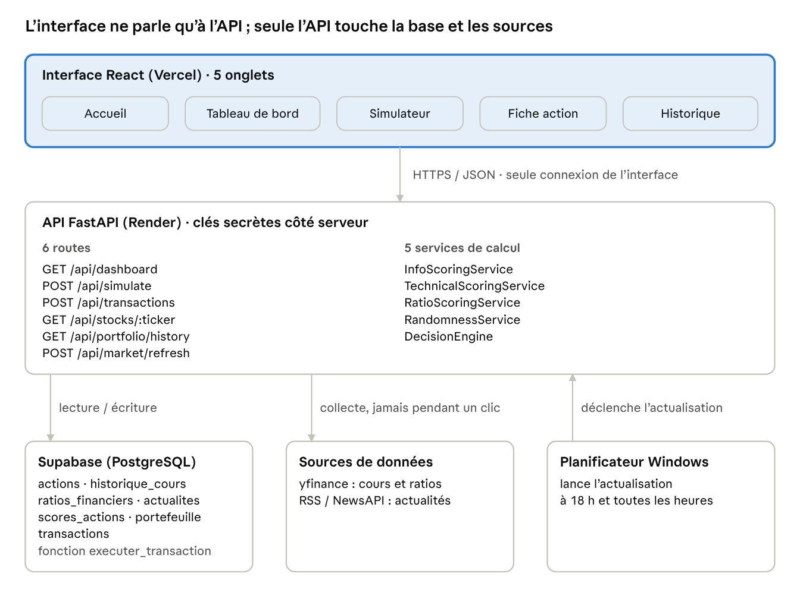
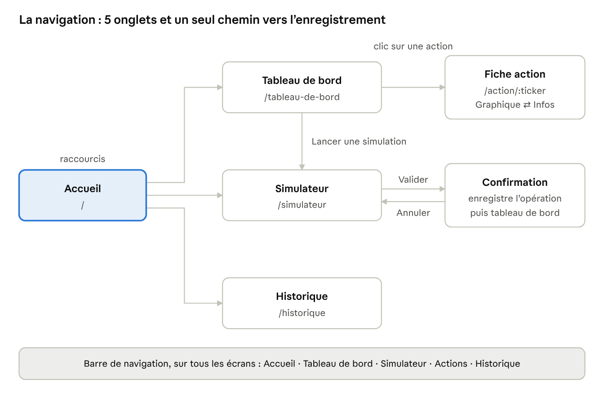
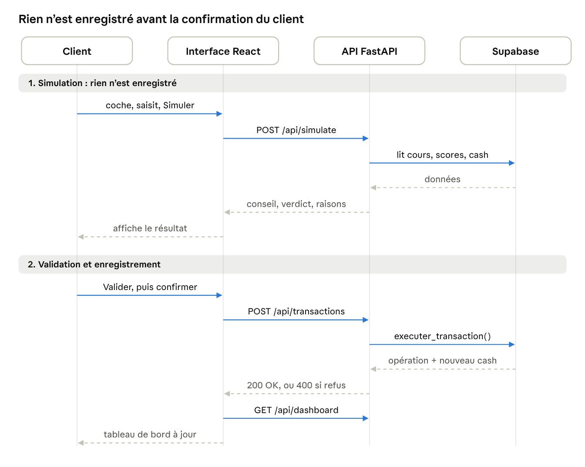

# Dossier interface — Portefeuille 500k

Composants, connexions, interactions et charte graphique · Nov 25, 2026 · @dread

## 1. Objet du document

Ce dossier rassemble en un seul endroit tout ce qui concerne l'**interface** de l'application d'aide à la décision sur le portefeuille de 500 000 € :

- les écrans, leurs composants et la façon dont on passe de l'un à l'autre ;

- les connexions de chaque composant avec l'API et avec l'extérieur ;

- les interactions entre les éléments, parcours par parcours ;

- la charte graphique (couleurs, typographie, mise en page, composants).

Il remplace et complète le DSL « Composants UI et connexions externes » : depuis, une page d'accueil a été ajoutée et le simulateur a été séparé du tableau de bord.

| Document                                   | Rôle                                    | Lien                                                                                      |
|--------------------------------------------|-----------------------------------------|-------------------------------------------------------------------------------------------|
| Cahier des charges fonctionnel (CdCF v2.0) | Besoins du client, règles RG-01 à RG-06 | Document du groupe                                                                        |
| Dossier de conception technique (DCT v1.0) | Architecture, tables, routes de l'API   | Document du groupe                                                                        |
| Charte graphique                           | Tokens, composants et aperçus en direct | [Charte graphique — Portefeuille 500k](https://claude.ai/artifact/8DHsZrC4sVnTsV5pBYBNeG) |
| Maquettes                                  | Les 8 écrans, prototype cliquable       | [Maquettes — Portefeuille 500k](https://claude.ai/artifact/R6A3F9BZ2hN9YU8wG35xCC)        |
| Schéma Canva                               | Composants et connexions en 5 planches  | [Architecture décision financière](https://www.canva.com/d/N0hZMVMT1Z8_rhV)               |

**Stack de l'interface** : React 18 + Vite, Tailwind + shadcn/ui, TradingView Lightweight Charts (cours), Recharts (performance). Développement sous Windows.

**Règle de base** : l'interface ne parle qu'à l'API FastAPI. Elle n'appelle jamais directement Supabase, yfinance ou NewsAPI, et ne contient aucune clé secrète.

## 2. Architecture

Architecture · 4 blocs et leurs connexions

L’application est découpée en quatre blocs. L’**interface React** (hébergée sur Vercel) affiche les écrans ; elle n’a qu’un seul interlocuteur, l’**API FastAPI** (hébergée sur Render), qu’elle appelle en HTTPS avec des échanges JSON. L’API calcule les conseils, lit et écrit dans **Supabase**, et va chercher les cours et les actualités auprès des **sources de données**. Le **Planificateur de tâches Windows** déclenche cette collecte automatiquement.

Conséquence pratique : un clic du client ne déclenche jamais d’appel à yfinance ou NewsAPI. Tout ce que l’interface affiche est déjà calculé et rangé dans Supabase, d’où une réponse en moins de 2 secondes (ENF du CdCF).

## 3. Les écrans et la navigation

Navigation · 5 onglets, fiche action et confirmation

L’application s’ouvre sur l’**Accueil**. Une barre de navigation, présente sur tous les écrans, donne accès aux 5 onglets. Le seul chemin qui enregistre quelque chose passe par le **Simulateur** puis la **fenêtre de confirmation** ; tous les autres écrans ne font que lire.

| Écran           | Route                           | À quoi il sert                                            | Exigence                   | Maquette                                                                                                                                                             |
|-----------------|---------------------------------|-----------------------------------------------------------|----------------------------|----------------------------------------------------------------------------------------------------------------------------------------------------------------------|
| Accueil         | /                               | Saluer le client, résumer sa semaine, l’orienter          | —                          | [Accueil](https://claude.ai/artifact/R6A3F9BZ2hN9YU8wG35xCC#artboard-Accueil)                                                                                        |
| Tableau de bord | /tableau-de-bord                | Valeur, alerte de perte, conseil sur les 5 actions        | EF-01, RG-01               | [Tableau de bord](https://claude.ai/artifact/R6A3F9BZ2hN9YU8wG35xCC#artboard-Main)                                                                                   |
| Simulateur      | /simulateur                     | Tester un achat ou une vente, obtenir un conseil, valider | EF-02, RG-02, RG-03, RG-05 | [Simulateur](https://claude.ai/artifact/R6A3F9BZ2hN9YU8wG35xCC#artboard-Simulateur)                                                                                  |
| Confirmation    | fenêtre au-dessus du simulateur | Récapituler et enregistrer l’opération                    | RG-05                      | [Confirmation](https://claude.ai/artifact/R6A3F9BZ2hN9YU8wG35xCC#artboard-Confirmation)                                                                              |
| Fiche action    | /action/:ticker                 | Graphique, indicateurs, conseil argumenté, onglet Infos   | EF-03, RG-03               | [Graphique](https://claude.ai/artifact/R6A3F9BZ2hN9YU8wG35xCC#artboard-FicheAction) · [Infos](https://claude.ai/artifact/R6A3F9BZ2hN9YU8wG35xCC#artboard-FicheInfos) |
| Historique      | /historique                     | Opérations et performance sur un an                       | RG-06                      | [Historique](https://claude.ai/artifact/R6A3F9BZ2hN9YU8wG35xCC#artboard-Historique)                                                                                  |

L’écran d’alerte ([maquette](https://claude.ai/artifact/R6A3F9BZ2hN9YU8wG35xCC#artboard-Alerte)) n’est pas une page à part : c’est le tableau de bord quand la perte de la semaine atteint −10 %.

## 4. Composants de l’interface et leurs connexions

Pour chaque écran : les composants React, ce qu’ils affichent et la route de l’API qui les alimente. La colonne « Charte » indique le composant de la charte graphique à utiliser (section 8).

### 4.1 Composants communs

| Composant                 | Rôle                                                                                      | Données                               | Connexion                                     | Charte      |
|---------------------------|-------------------------------------------------------------------------------------------|---------------------------------------|-----------------------------------------------|-------------|
| AppLayout                 | Cadre de l’application                                                                    | —                                     | Aucune                                        | —           |
| NavBar                    | 5 onglets, nom de l’application (retour à l’accueil), date des données, bouton Actualiser | Horodatage de la dernière mise à jour | GET /api/dashboard ; POST /api/market/refresh | Button      |
| AlertBanner               | Bandeau d’alerte de perte (RG-01), sur toutes les pages                                   | Niveau d’alerte, perte de la semaine  | GET /api/dashboard                            | AlertBanner |
| Toast                     | Message court de succès ou d’erreur                                                       | Message renvoyé par l’API             | Toutes les routes                             | —           |
| LoadingState / ErrorState | Squelette de chargement ; message et bouton Réessayer                                     | —                                     | Toutes les routes                             | —           |

Un seul module src/api/client.js regroupe les appels à l’API ; son adresse vient de la variable VITE_API_URL.

### 4.2 Accueil (/)

| Composant     | Rôle                                                                  | Données                   | Connexion           | Charte        |
|---------------|-----------------------------------------------------------------------|---------------------------|---------------------|---------------|
| WelcomeHeader | « Bonjour M. X, bienvenue », date du jour, état des données           | Nom du client, horodatage | GET /api/dashboard  | —             |
| SummaryCards  | Valeur du portefeuille, performance de la semaine, cash               | Capital, variation, cash  | GET /api/dashboard  | KpiCard       |
| WeeklyAdvice  | Les 5 actions classées en Achat, Rien, Vente ; un clic ouvre la fiche | Conseil par titre         | GET /api/dashboard  | DecisionBadge |
| QuickLinks    | Raccourcis vers Tableau de bord, Simulateur, Historique               | —                         | Aucune (navigation) | —             |
| GoalsReminder | Rappel des objectifs : +10 % par semaine, perte maximale −10 %        | Fixe (CdCF)               | Aucune              | —             |

### 4.3 Tableau de bord (/tableau-de-bord)

| Composant     | Rôle                                                                     | Données                                                                   | Connexion           | Charte        |
|---------------|--------------------------------------------------------------------------|---------------------------------------------------------------------------|---------------------|---------------|
| KpiCards      | 4 cartes : capital total, cash, performance de la semaine, part investie | Montants et pourcentages                                                  | GET /api/dashboard  | KpiCard       |
| RiskIndicator | Jauge de la perte de la semaine, repères à −7 % et −10 %                 | Variation de la semaine                                                   | GET /api/dashboard  | —             |
| StocksTable   | Les 5 actions ; un clic ouvre la fiche                                   | Cours, variation du jour, actions détenues, conseil, prévision, dividende | GET /api/dashboard  | DecisionBadge |
| SimulateLink  | Bouton « Lancer une simulation »                                         | —                                                                         | Aucune (navigation) | Button        |

### 4.4 Simulateur (/simulateur)

| Composant       | Rôle                                                                                                    | Données                                    | Connexion                                       | Charte                  |
|-----------------|---------------------------------------------------------------------------------------------------------|--------------------------------------------|-------------------------------------------------|-------------------------|
| SimulatorHeader | Rappel du cash disponible et de la perte de la semaine                                                  | Cash, variation                            | GET /api/dashboard                              | —                       |
| StockCheckboxes | 5 cases à cocher                                                                                        | Liste fixe des 5 titres                    | Aucune                                          | StockCheckbox           |
| OperationToggle | Achat ou Vente                                                                                          | —                                          | Aucune                                          | —                       |
| AmountInput     | Montant en euros, contrôlé avant envoi                                                                  | Montant saisi                              | Aucune                                          | AmountInput             |
| SimulateButton  | Demande le conseil ; rien n’est enregistré                                                              | Titres, montant, opération                 | POST /api/simulate                              | Button                  |
| AdviceCard      | Résultat par titre : conseil, verdict, nombre d’actions, reste en cash, 3 scénarios, dividende, raisons | Réponse de la simulation                   | POST /api/simulate                              | AdviceCard, ForecastBar |
| ConfirmDialog   | Fenêtre de confirmation ; enregistre puis renvoie au tableau de bord                                    | Titre, actions, cours, montant, cash après | POST /api/transactions, puis GET /api/dashboard | Button                  |

### 4.5 Fiche action (/action/:ticker)

Tous les composants sont alimentés par **un seul appel**, GET /api/stocks/{ticker}, fait à l’ouverture.

| Composant                     | Rôle                                                                                        | Données               | Charte        |
|-------------------------------|---------------------------------------------------------------------------------------------|-----------------------|---------------|
| StockHeader                   | Nom, code, cours, variation, conseil, note, actions détenues                                | En-tête de la réponse | DecisionBadge |
| ChartTabs                     | Onglets « Graphique » et « Infos sur l’action »                                             | —                     | —             |
| PriceChart + IndicatorToggles | Bougies, moyennes mobiles 20 / 50 / 200 jours, bandes de Bollinger ; période 1M, 3M, 6M, 1A | Cours et indicateurs  | —             |
| RsiPanel / MacdPanel          | RSI 14 jours, MACD 12 / 26 / 9                                                              | Indicateurs           | —             |
| RecommendationCard            | Conseil, note sur 100 avec les seuils, 2 à 4 raisons (RG-03)                                | Note et raisons       | DecisionBadge |
| ForecastCard                  | 3 scénarios de la semaine en % et en euros                                                  | Prévision             | ForecastBar   |
| DividendSimulator             | Nombre d’actions saisi → dividende annuel estimé (calcul dans le navigateur)                | Dividende par action  | AmountInput   |
| NewsList (onglet Infos)       | Actualités notées sur 100, lien vers l’article                                              | Actualités            | —             |
| RatiosTable (onglet Infos)    | Chiffre d’affaires, dividende, rendement sur deux exercices                                 | Ratios                | —             |
| PillarWeights (onglet Infos)  | Poids et note de chaque pilier dans le conseil                                              | Détail des piliers    | —             |

### 4.6 Historique (/historique)

Alimenté par GET /api/portfolio/history, rappelé à chaque changement de filtre ou de page.

| Composant                      | Rôle                                                                                | Données            | Charte                |
|--------------------------------|-------------------------------------------------------------------------------------|--------------------|-----------------------|
| PeriodFilter                   | Période (1 semaine à 1 an) et titre                                                 | Paramètres envoyés | —                     |
| HistorySummary                 | Valeur, plus-values réalisées, dividendes estimés, nombre d’opérations              | Bilan              | KpiCard               |
| PerformanceChart               | Valeur du portefeuille jour par jour, achats et ventes marqués, ligne des 500 000 € | Courbe             | —                     |
| TransactionsTable + Pagination | Journal des opérations avec le conseil donné à ce moment                            | Transactions       | DecisionBadge, Button |

## 5. Interactions entre les éléments

Cette section décrit, parcours par parcours, ce qui se passe entre le client, l’interface, l’API et la base.

### 5.1 Ouvrir l’application

1.  Le client arrive sur l’**Accueil**. L’interface appelle GET /api/dashboard.

2.  La réponse remplit le résumé (valeur, semaine, cash), les conseils de la semaine et, si besoin, le bandeau d’alerte.

3.  Si l’API ne répond pas, l’écran affiche ErrorState avec un bouton Réessayer.

La même réponse sert au tableau de bord : l’interface la garde en mémoire pendant la session et ne la redemande qu’après une opération ou une actualisation.

### 5.2 Simuler puis enregistrer une opération

Séquence · simuler puis enregistrer une opération

1.  **Simulation.** Le client coche une ou plusieurs actions, choisit Achat ou Vente et saisit un montant. Le montant est contrôlé dans le navigateur (vide, nul ou négatif → message sous le champ). Le clic sur Simuler envoie POST /api/simulate.

2.  **Résultat.** L’API lit les cours, les scores de la semaine et le cash, puis renvoie pour chaque titre : nombre d’actions entières, reste en cash, conseil, verdict, 3 scénarios, dividende estimé, raisons et niveau d’alerte. AdviceCard l’affiche. **Rien n’est enregistré.**

3.  **Validation.** « Valider l’achat » (désactivé si le verdict est « Refusé ») ouvre ConfirmDialog avec le récapitulatif et le cash après l’opération. « Annuler » ferme la fenêtre et laisse le simulateur tel quel.

4.  **Enregistrement.** La confirmation envoie POST /api/transactions. L’API appelle la fonction executer_transaction qui revérifie le cash (ou les actions détenues), enregistre l’opération et met à jour le cash **d’un seul bloc**.

5.  **Retour.** En cas de succès : Toast « Achat enregistré », nouvel appel GET /api/dashboard, puis le tableau de bord s’affiche à jour. En cas de refus (code 400 : cash insuffisant, cours changé, conseil de plus de 5 minutes) : Toast rouge avec la raison, la fenêtre reste ouverte et rien n’est enregistré.

### 5.3 Consulter une action

1.  Un clic sur une ligne du tableau de bord ou sur un nom dans l’Accueil ouvre /action/{ticker}.

2.  L’interface appelle GET /api/stocks/{ticker} une seule fois ; les deux onglets (Graphique et Infos) utilisent la même réponse, sans nouvel appel.

3.  Les boutons de période et les cases des indicateurs changent seulement l’affichage du graphique. Le simulateur de dividende calcule dans le navigateur.

4.  Un code inconnu renvoie une erreur 404 : la page affiche « action inconnue » et un lien vers le tableau de bord.

### 5.4 Actualiser les données

1.  **Automatiquement** : le Planificateur de tâches Windows appelle POST /api/market/refresh à 18 h (cours) et toutes les heures (actualités).

2.  **À la demande** : le bouton « Actualiser les données » de la barre de navigation fait le même appel, affiche un indicateur de chargement, puis rappelle GET /api/dashboard.

3.  La date affichée dans la barre de navigation change. Si une source est en panne, les dernières données valides restent affichées avec leur date, sur fond warn.

### 5.5 Alerte de perte (RG-01)

1.  Le niveau d’alerte est recalculé par l’API à chaque actualisation et après chaque opération ; il arrive dans la réponse de GET /api/dashboard.

2.  À **−7 %** (approche) : bandeau orange sur toutes les pages, et le simulateur ne conseille plus aucun achat.

3.  À **−10 %** (atteinte) : bandeau rouge sur toutes les pages, vente conseillée sur les positions en baisse.

4.  Chaque lundi à l’ouverture, la valeur de référence est remise à jour et l’alerte repart de zéro.

### 5.6 Ce qui se met à jour, et où

| Événement                 | Accueil | Tableau de bord | Simulateur | Fiche action     | Historique | Bandeau d’alerte |
|---------------------------|---------|-----------------|------------|------------------|------------|------------------|
| Opération enregistrée     | ✓       | ✓               | cash       | actions détenues | ✓          | ✓                |
| Actualisation des données | ✓       | ✓               | ✓          | ✓                | courbe     | ✓                |
| Nouvelle semaine (lundi)  | ✓       | ✓               | ✓          | —                | —          | remis à zéro     |

### 5.7 Historique

Le changement de période, de titre ou de page rappelle GET /api/portfolio/history avec ces paramètres. La courbe, le bilan et le journal se mettent à jour ensemble.

## 6. Connexions avec l’extérieur

### 6.1 Interface → API FastAPI

Seule connexion de l’interface : HTTPS, échanges JSON, origine limitée au site Vercel (CORS).

| Route                      | Appelée par                                                         | Quand                                               | Envoie                                           | Reçoit                                                                                              |
|----------------------------|---------------------------------------------------------------------|-----------------------------------------------------|--------------------------------------------------|-----------------------------------------------------------------------------------------------------|
| GET /api/dashboard         | Accueil, Tableau de bord, Simulateur (en-tête), NavBar, AlertBanner | Ouverture, après une opération ou une actualisation | —                                                | Capital, cash, performance de la semaine, niveau d’alerte, 5 lignes (conseil, prévision, dividende) |
| POST /api/simulate         | SimulateButton                                                      | Clic sur Simuler                                    | Titres, montant, opération                       | Par titre : actions entières, reste, conseil, verdict, raisons, prévision, dividende, alerte        |
| POST /api/transactions     | ConfirmDialog                                                       | Confirmation                                        | Titre, opération, nombre d’actions, conseil reçu | Opération enregistrée et nouveau cash, ou erreur 400                                                |
| GET /api/stocks/{ticker}   | Fiche action                                                        | Ouverture de la fiche                               | Code dans l’adresse                              | Cours, indicateurs, actualités, ratios, scénarios, raisons                                          |
| GET /api/portfolio/history | Historique                                                          | Ouverture, filtre, page                             | Période, titre, page                             | Opérations, courbe, bilan                                                                           |
| POST /api/market/refresh   | Bouton Actualiser, Planificateur Windows                            | Clic, 18 h, toutes les heures                       | —                                                | Confirmation et horodatage                                                                          |

### 6.2 API → Supabase

L’API est la seule à lire et écrire dans la base. Sa clé reste dans le fichier .env du serveur.

| Table ou fonction | Lue pour                                     | Écrite par                                          |
|-------------------|----------------------------------------------|-----------------------------------------------------|
| actions           | Toutes les routes (nom, code, dernier cours) | Actualisation                                       |
| historique_cours  | Graphique et indicateurs                     | Actualisation                                       |
| ratios_financiers | Onglet Infos, pilier Ratios                  | Actualisation                                       |
| actualites        | Onglet Infos, pilier Informations            | Actualisation                                       |
| scores_actions    | Accueil, tableau de bord, simulateur, fiche  | Recalcul des conseils                               |
| portefeuille      | Accueil, tableau de bord, simulateur         | executer_transaction ; valeur de référence du lundi |
| transactions      | Historique, actions détenues                 | executer_transaction                                |

### 6.3 Sources de données

Appelées **uniquement pendant une actualisation**, jamais pendant un clic du client.

| Source                          | Fournit                                          | Fréquence                 | En cas d’échec                                 |
|---------------------------------|--------------------------------------------------|---------------------------|------------------------------------------------|
| yfinance                        | Cours quotidiens, chiffre d’affaires, dividendes | Chaque jour à 18 h        | Derniers cours connus, affichés avec leur date |
| Flux RSS / NewsAPI              | Actualités des 5 entreprises                     | Toutes les heures         | Actualités déjà en base conservées             |
| Planificateur de tâches Windows | Déclenche l’actualisation (tools\refresh.ps1)    | 18 h et toutes les heures | Actualisation manuelle possible                |

Les clés SUPABASE_KEY et NEWS_API_KEY sont stockées uniquement côté serveur.

### 6.4 Ce que voit le client en cas de problème

| Situation                                                 | Code                       | Affichage                                             |
|-----------------------------------------------------------|----------------------------|-------------------------------------------------------|
| Montant vide, nul ou négatif                              | 422 (bloqué dès la saisie) | Message sous AmountInput                              |
| Cash insuffisant ou vente supérieure aux actions détenues | 400                        | Toast rouge ; rien n’est enregistré                   |
| Cours changé ou conseil de plus de 5 minutes              | 400                        | Toast : « le cours a changé, relancez la simulation » |
| Code d’action inconnu                                     | 404                        | Page « action inconnue »                              |
| API injoignable                                           | —                          | ErrorState avec Réessayer                             |
| Source externe en panne                                   | 200                        | Date des dernières données valides, sur fond warn     |

## 7. Charte graphique

La version interactive (aperçus en direct, thème clair et sombre) est ici : [Charte graphique — Portefeuille 500k](https://claude.ai/artifact/8DHsZrC4sVnTsV5pBYBNeG). L’application n’a pas encore de logo : le nom « Portefeuille 500k » s’écrit en Inter 600, couleur ink.

### 7.1 Principes

1.  **Le conseil d’abord.** Sur chaque écran, le client voit en moins de 3 secondes le conseil, la valeur du portefeuille et l’état de l’alerte.

2.  **Sobre et sérieux.** Fonds clairs, peu d’ombres, pas de dégradés ni d’animations décoratives. La couleur sert à signaler, pas à décorer.

3.  **Honnête sur le risque.** Les pertes sont aussi visibles que les gains ; une prévision montre toujours ses 3 scénarios.

4.  **Lisible par tous.** Tout texte atteint un contraste de 4.5:1 dans les deux thèmes ; un conseil porte toujours son mot et son signe (▲ ACHAT, ▼ VENTE, ■ RIEN).

### 7.2 Ton et formats

- L’application vouvoie le client ; phrases courtes ; verbe d’action en tête des boutons (« Simuler », « Valider l’achat »).

- Pas de jargon non expliqué, pas de point d’exclamation, pas d’emoji, pas de promesse.

- Un conseil est une aide, jamais un ordre : « Conseil : ACHAT », pas « Achetez ».

| Donnée                         | Format                                                       | Exemple             |
|--------------------------------|--------------------------------------------------------------|---------------------|
| Montant                        | espace fine pour les milliers, virgule, 2 décimales, € après | 49 972,80 €         |
| Grand montant (carte chiffrée) | sans décimales au-delà de 100 000 €                          | 503 067 €           |
| Pourcentage                    | signe toujours affiché, 1 décimale                           | +3,2 % · −1,8 %     |
| Nombre d’actions               | entier                                                       | 1 436 actions       |
| Date                           | jour, mois abrégé, année, heure 24 h                         | 25 nov. 2026, 18:02 |
| Code boursier                  | police mono, majuscules                                      | DSY.PA              |

### 7.3 Couleurs

Chaque couleur est un token à deux valeurs (thème clair, thème sombre). Dans le code, on utilise toujours la variable CSS (var(--buy)), jamais la valeur en dur.

**Surfaces et texte**

| Token          | Clair    | Sombre   | Usage                                               |
|----------------|----------|----------|-----------------------------------------------------|
| surface-page   | \#f5f7f9 | \#0e141a | Fond de page (derrière les cartes)                  |
| surface-card   | \#ffffff | \#161e27 | Fond des cartes, tableaux, panneaux, fenêtres       |
| surface-sunken | \#edf0f3 | \#1e2832 | Survol de ligne, champ désactivé, piste d’une jauge |
| line           | \#d5dbe2 | \#2a3541 | Bordures de cartes, séparateurs                     |
| line-strong    | \#8a96a3 | \#5f6c79 | Bordure des champs, cases et boutons secondaires    |
| ink            | \#101a24 | \#e7ecf1 | Texte principal et chiffres clés                    |
| ink-muted      | \#4f5d6b | \#9ba8b5 | Libellés, légendes, dates, aides                    |

**Marque**

| Token      | Clair    | Sombre   | Usage                                                             |
|------------|----------|----------|-------------------------------------------------------------------|
| brand      | \#0a5c6a | \#5cbccc | Bleu pétrole : bouton principal, liens, onglet actif, RSI et MACD |
| on-brand   | \#ffffff | \#062a31 | Texte sur un fond brand                                           |
| brand-soft | \#e0eff1 | \#123a42 | Ligne sélectionnée, case cochée, bandes de Bollinger              |
| focus      | = brand  | = brand  | Anneau de focus clavier, 2 px                                     |

**Conseil et alerte**

| Token     | Clair    | Sombre   | Usage                                                     |
|-----------|----------|----------|-----------------------------------------------------------|
| buy       | \#11704a | \#4fca8d | Conseil ACHAT, hausse, bougie haussière, gain             |
| on-buy    | \#ffffff | \#06241a | Texte sur fond buy (bouton « Valider l’achat »)           |
| buy-soft  | \#e2f2e9 | \#0f3122 | Fond du badge ACHAT                                       |
| sell      | \#b42318 | \#ff7b6e | Conseil VENTE, baisse, perte, alerte atteinte (−10 %)     |
| on-sell   | \#ffffff | \#2a0906 | Texte sur fond sell (bandeau rouge, « Valider la vente ») |
| sell-soft | \#fbe8e6 | \#3d1714 | Fond du badge VENTE et des erreurs                        |
| hold      | \#56616d | \#a6b0bb | Conseil RIEN, verdict « Ne rien faire »                   |
| hold-soft | \#eceff2 | \#232d37 | Fond du badge RIEN                                        |
| warn      | \#8f5300 | \#f2b04a | Alerte d’approche (−7 %), données anciennes               |
| warn-soft | \#fcefd8 | \#3a2a0d | Fond du bandeau d’alerte orange                           |

**Graphiques**

| Token       | Clair       | Sombre      | Usage                    |
|-------------|-------------|-------------|--------------------------|
| chart-dsy   | \#2f6bd6    | \#6f9bff    | Dassault Systèmes        |
| chart-tte   | \#a86400    | \#e0a03a    | TotalEnergies            |
| chart-cap   | \#7048c8    | \#a58bff    | Capgemini                |
| chart-rms   | \#0d8a84    | \#3cc7bf    | Hermès                   |
| chart-ai    | \#b0307a    | \#ef6fb3    | Air Liquide              |
| chart-ma20  | = chart-tte | = chart-tte | Moyenne mobile 20 jours  |
| chart-ma50  | = chart-cap | = chart-cap | Moyenne mobile 50 jours  |
| chart-ma200 | = ink-muted | = ink-muted | Moyenne mobile 200 jours |
| chart-grid  | = line      | = line      | Quadrillage et axes      |

Règles d’usage :

- brand n’est jamais un conseil : il ne signifie pas « acheter ».

- Vert, rouge et gris sont réservés à Achat, Vente et Rien (et à hausse, baisse, gain, perte).

- Un seul fond plein de signal par écran : le bandeau rouge ou le bouton de validation. Ailleurs, les versions -soft.

- Les 5 titres gardent la même couleur dans tous les graphiques.

- Contrastes vérifiés : ink sur carte 17.6:1 (clair) et 14.1:1 (sombre) ; le pire cas, ink-muted sur surface-sunken, 5.9:1 ; les badges entre 5.3:1 et 7.3:1 ; les bordures de champ 3:1.

### 7.4 Typographie

**Inter** (Google Fonts) pour toute l’interface ; **IBM Plex Mono** uniquement pour les codes boursiers. Chiffres tabulaires obligatoires dans les tableaux et les cartes chiffrées ; montants alignés à droite.

| Style   | Taille / interligne    | Graisse | Usage                                             |
|---------|------------------------|---------|---------------------------------------------------|
| display | 32 / 40 px             | 700     | Valeur totale du portefeuille, une fois par écran |
| h1      | 24 / 32 px             | 600     | Titre de page                                     |
| h2      | 18 / 26 px             | 600     | Titre de carte ou de section                      |
| body    | 15 / 22 px             | 400     | Texte courant, raisons, actualités                |
| body-sm | 13 / 18 px             | 400     | Cellules de tableau, légendes, aides              |
| label   | 12 / 16 px, majuscules | 600     | Libellés de cartes, en-têtes de colonnes          |
| kpi     | 28 / 34 px             | 600     | Valeur d’une carte chiffrée                       |
| number  | 15 / 22 px             | 500     | Montants et pourcentages des tableaux             |
| ticker  | 13 / 18 px, mono       | 500     | Code boursier                                     |

### 7.5 Espacements, rayons, ombres

| Token                      | Valeur          | Usage                                                |
|----------------------------|-----------------|------------------------------------------------------|
| space-1 à space-4          | 4, 8, 12, 16 px | Écarts internes, marge des cartes                    |
| space-6, space-8, space-12 | 24, 32, 48 px   | Gouttière de grille, entre sections, haut de page    |
| radius-sm / -md / -lg      | 4 / 8 / 12 px   | Badges ; boutons et champs ; cartes et fenêtres      |
| shadow-card                | ombre légère    | Cartes (qui se distinguent surtout par leur bordure) |
| shadow-dialog              | ombre marquée   | Fenêtre de confirmation                              |

### 7.6 Mise en page

- Grille de 12 colonnes, largeur maximale 1 280 px, gouttière 24 px, marges 24 px (16 px sur mobile).

- Barre de navigation fixe de 64 px ; le bandeau d’alerte juste dessous, sur toute la largeur.

- Cartes : fond surface-card, bordure line, rayon radius-lg, marge 16 à 24 px.

- Sur mobile, tout passe en une colonne et les tableaux défilent horizontalement.

### 7.7 Graphiques

- Cours (TradingView Lightweight Charts) : bougies buy / sell, quadrillage chart-grid.

- MM20, MM50, MM200 en traits de 1,5 px ; bandes de Bollinger en zone brand-soft bordée de brand.

- RSI et MACD dans deux panneaux de 96 px sous le graphique ; repères 30 et 70 du RSI en pointillés.

- Performance (Recharts) : ligne brand de 2 px, ligne pointillée des 500 000 € de départ, achats et ventes marqués ▲ / ▼.

- Légende toujours visible ; pas de 3D, pas de double axe vertical.

### 7.8 Icônes et états

Icônes **Lucide** (fournies avec shadcn/ui), trait 1,75 px, 16 px dans le texte et 20 px dans les boutons, couleur du texte. Toute icône seule a un libellé accessible.

| État               | Rendu                                                   |
|--------------------|---------------------------------------------------------|
| Survol d’une ligne | Fond surface-sunken                                     |
| Focus clavier      | Anneau focus de 2 px, décalé de 2 px                    |
| Désactivé          | Opacité 0,5                                             |
| Chargement         | Squelette surface-sunken à la forme du contenu          |
| Erreur             | Message sell sous le champ, ou Toast sur fond sell-soft |
| Données anciennes  | Badge warn avec la date                                 |

## 8. Composants de la charte

Huit composants sont définis par la charte. Ils sont réutilisés tels quels dans les maquettes et devront l’être dans le code React.

| Composant     | Ce qu’il montre                    | Règles clés                                                                                                             | Utilisé dans                                                                  |
|---------------|------------------------------------|-------------------------------------------------------------------------------------------------------------------------|-------------------------------------------------------------------------------|
| Button        | Action, verbe en tête              | primary une seule fois par écran ; buy / sell uniquement dans la confirmation ; 40 px de haut (32 px dans les tableaux) | NavBar, SimulateButton, ConfirmDialog, Pagination                             |
| DecisionBadge | ▲ ACHAT, ▼ VENTE, ■ RIEN           | Toujours le signe et le mot ; fond -soft ; RIEN est gris, pas orange                                                    | StocksTable, WeeklyAdvice, StockHeader, RecommendationCard, TransactionsTable |
| KpiCard       | Libellé, valeur, variation ou aide | Reçoit une valeur déjà formatée ; variation avec signe et flèche                                                        | SummaryCards, KpiCards, HistorySummary                                        |
| AlertBanner   | Alerte de perte de la semaine      | Rien à 0 %, orange de −7 % à −10 %, rouge à −10 % ; ne se ferme pas tant que l’alerte dure                              | Toutes les pages                                                              |
| AmountInput   | Montant en euros                   | Aligné à droite, € fixe, aide = cash disponible, erreur en sell                                                         | Simulateur, simulateur de dividende                                           |
| StockCheckbox | Une des 5 actions                  | Pastille de la couleur du titre ; toute la ligne est cliquable                                                          | Simulateur                                                                    |
| ForecastBar   | 3 scénarios de la semaine          | Toujours les trois, dans l’ordre ; le central mis en avant ; montant en euros si fourni                                 | AdviceCard, ForecastCard                                                      |
| AdviceCard    | Résultat d’une simulation          | Ordre fixe : conseil, verdict, chiffres, prévision, raisons, boutons                                                    | Simulateur                                                                    |

### 8.1 Brancher la charte dans le projet React

Les tokens deviennent des variables CSS (tokens.css, fourni par la charte). Dans tailwind.config.js :

theme: { extend: {  
colors: {  
page: 'var(--surface-page)', card: 'var(--surface-card)', sunken: 'var(--surface-sunken)',  
line: 'var(--line)', ink: 'var(--ink)', muted: 'var(--ink-muted)',  
brand: { DEFAULT: 'var(--brand)', soft: 'var(--brand-soft)', on: 'var(--on-brand)' },  
buy: { DEFAULT: 'var(--buy)', soft: 'var(--buy-soft)', on: 'var(--on-buy)' },  
sell: { DEFAULT: 'var(--sell)', soft: 'var(--sell-soft)', on: 'var(--on-sell)' },  
hold: { DEFAULT: 'var(--hold)', soft: 'var(--hold-soft)' },  
warn: { DEFAULT: 'var(--warn)', soft: 'var(--warn-soft)' },  
},  
borderRadius: { sm: 'var(--radius-sm)', md: 'var(--radius-md)', lg: 'var(--radius-lg)' },  
fontFamily: { sans: \['Inter', 'Segoe UI', 'system-ui', 'sans-serif'\], mono: \['IBM Plex Mono', 'Consolas', 'monospace'\] },  
}}

Le thème sombre s’active avec data-theme="dark" sur \<html\>.

## 9. Écarts avec le dossier de conception et points à valider

### 9.1 Changements par rapport au DCT v1.0

| Sujet               | Dans le DCT                                 | Dans ce dossier                                 | À reporter dans le DCT                                  |
|---------------------|---------------------------------------------|-------------------------------------------------|---------------------------------------------------------|
| Page d’accueil      | Absente                                     | AccueilPage sur /                               | Ajouter la page et sa route                             |
| Tableau de bord     | Sur /, simulateur intégré                   | Sur /tableau-de-bord, sans simulateur           | Changer la route                                        |
| Simulateur          | SimulatorPanel intégré à /                  | SimulatorPage sur /simulateur, onglet à part    | Ajouter la page et sa route                             |
| Barre de navigation | Non décrite                                 | 5 onglets + bouton Actualiser                   | Ajouter le composant                                    |
| Réponse de l’API    | Sans verdict ni niveau d’alerte             | Champs verdict et niveau_alerte                 | Compléter les contrats JSON                             |
| Enregistrement      | « Transaction SQL atomique »                | Fonction executer_transaction appelée par l’API | Ajouter la fonction au script SQL                       |
| Table actualites    | Colonne resume citée mais absente du script | Utilisée par l’onglet Infos                     | Ajouter la colonne                                      |
| Nom du client       | Non prévu                                   | Affiché sur l’Accueil                           | Ajouter un champ (par ex. nom_client dans portefeuille) |

### 9.2 Points à valider avec le groupe ou le client

- [ ] Le nom de l’application (« Portefeuille 500k » provisoire) et un logo.

- [ ] La couleur principale (bleu pétrole) et la police (Inter).

- [ ] Les seuils de conseil (achat à 60, vente à 40) et l’alerte orange à −7 %.

- [ ] Plusieurs actions cochées : le montant s’applique-t-il à chacune, ou se répartit-il ?

- [ ] Faut-il une version mobile et un thème sombre dans les maquettes ?

- [ ] Les composants ajoutés qui ne sont pas dans le DCT : RefreshButton, LastUpdateBadge, IndicatorToggles, RsiPanel, MacdPanel, Pagination, PillarWeights.

Les valeurs affichées dans les maquettes (cours, actualités, ratios) sont des **données d’exemple**, cohérentes entre elles mais fictives.
